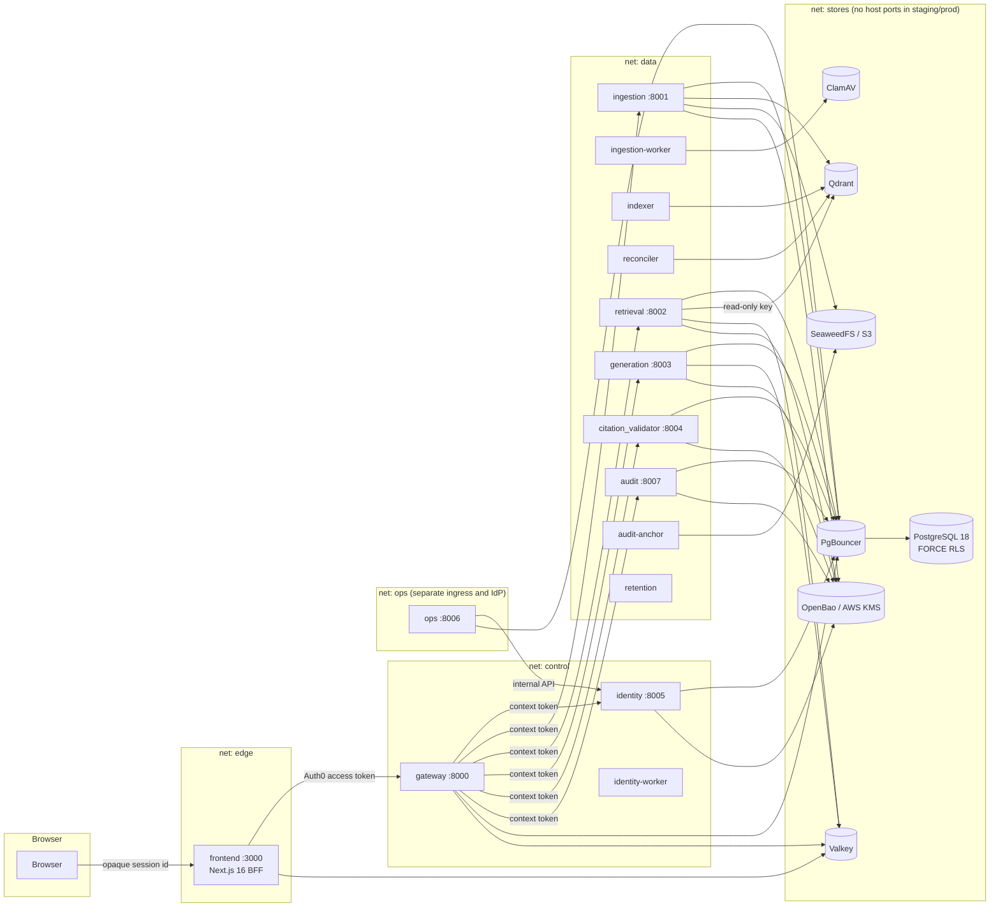
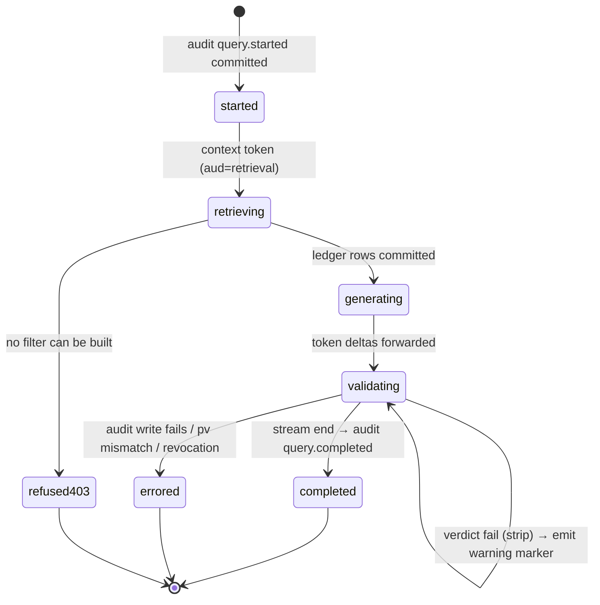

# Design Document

## Overview

This design takes the existing MVP ("Cyte", this repository) to the v3.1 system described in
`/home/gk/Downloads/LMQA/project-blueprint/Legal-Medical-QA-Master-System-Design-v3.1.md` (cited as §n). The
requirements are in `requirements.md` (R-1 to R-100), with the MVP deviation register (DEV-01 to DEV-50) and open
questions (Q-01 to Q-35). This document cites those IDs instead of repeating them.

The target architecture is the design's, not an AWS-native one: Auth0 authenticates, PostgreSQL 18 with FORCE RLS
authorizes, a Gateway fronts nine separate deployables, Qdrant sits behind the `lmqa_vectorstore` filtering wrapper,
per-organization keys sit behind the `lmqa_keys` provider interface (AWS KMS reference adapter, OpenBao locally), and
everything except Auth0, KMS, the anchor bucket, the LLM provider and a test mailbox runs on one host through Docker
Compose (C4). Kubernetes is deferred by the user; Compose networks stand in for network policies (see Q-02).

### Approach

1. **Reuse first.** Most v3.1 code already exists behind disabled flags in `contracts/features.toml` (migrations 0006
   to 0008, saga, governance, KeyGuard, NLI, Qdrant path, sentence streaming, operator plane). The work is mainly to
   apply, wire, test and gate that code, then remove the MVP paths it replaces.
2. **Stage by stage.** The repository is at `STAGE = 0` with Stage 1 to 9 code present (DEV-43). Delivery re-runs the
   gates from Stage 0 under the `full` profile and advances one stage at a time (§19.6, Q-14, Q-16). Each deviation is
   closed in the stage that owns it (table in Architecture).
3. **Flags as the cut-over switch.** A production path is enabled only when its bound gates attest (R-93). The MVP path
   it replaces is deleted in the same change that enables the flag, so the code never carries two live access paths.
4. **Follow the design where the MVP diverges, ask where the design is silent.** Where an open question remains
   (Q-04, Q-05, Q-07, Q-12, Q-13), this design states the v3.1 default and marks the item as pending that question.

### Key design decisions

| # | Decision | Rationale | Requirements / deviations |
| --- | --- | --- | --- |
| KD-1 | Split the single Gateway process into the nine §4.2 deployables on Compose, each with its own image (shared `infra/docker/service.Dockerfile` with a per-service target), DB role and credentials | §4.2 and the credential boundaries cannot hold inside one process | R-83, R-84, DEV-01 |
| KD-2 | Remove `lmqa_system` (BYPASSRLS) from every runtime path; one `NOBYPASSRLS` non-owner role per service; `super_admin` policy set; helpers owned by non-login `policy_helper` | RLS is the final authority only if nothing bypasses it | R-3, R-29, R-32, R-79, DEV-13, DEV-48 |
| KD-3 | Access decision is exactly §5.4 rules 1 to 8, implemented once in SQL (`app_can_read`), once as the Qdrant filter builder, once as the Python oracle in `lmqa_testing.oracle`; MVP rules 7a and 7b are migrated out | One rule set across RLS, filter and oracle (G1.4) | R-4, R-35, DEV-14 (pending Q-05) |
| KD-4 | Qdrant through `lmqa_vectorstore` is the request path; pgvector stays as the ADR 0004 fallback only | Design default (§10.5, D16) | R-35, R-36, DEV-02 (pending Q-07) |
| KD-5 | Self-hosted embeddings (`bge-m3` or Qwen3-Embedding) by default; third-party embeddings only as an organization-configured provider under BAA or no-retention terms | §11.8; no document text leaves the boundary by default | R-50, DEV-03 (pending Q-06) |
| KD-6 | Validator runs V1 to V8 only, V6 by the pinned ONNX NLI cross-encoder; the LLM entailment pass and the Q and L checks are removed | Determinism and "no generative LLM" (§11.6) | R-47, DEV-05, DEV-06 (pending Q-13) |
| KD-7 | `sentence_gated` streaming is the default delivery; `buffered` only with `on_fail = regenerate` | §11.6 | R-48, DEV-08 |
| KD-8 | Citation tags `[chunk_N]`, aliases `chunk_1..n` | §9.4, §11.5, V1 | R-46, R-47, DEV-07 (pending Q-12) |
| KD-9 | Column and object encryption through `lmqa_keys` (AES-256-GCM, per-workspace content keys, per-document keys) with a one-time re-encryption migration of existing plaintext rows | §12.2, §12.3 | R-51, R-52, DEV-09 |
| KD-10 | One audit chain per workspace plus one control chain per organization, monthly partitions, per-workspace-month HPKE keys | §13.3 | R-60, R-61, DEV-18 |
| KD-11 | Rate limits, code-failure counters and circuit breakers move to Valkey | Must hold across replicas (§7.6, §13.7) | R-16, R-64, DEV-27 |
| KD-12 | Migrations move to Alembic; existing SQL files become the bodies of Alembic revisions executed with `op.execute` | §4.5, §18; keeps the reviewed SQL | R-78, R-85, DEV-49 |
| KD-13 | MVP-only features (chats with LLM query planning, profiles, named shares, workspace visibility, usage counts, public site, LLM re-ranker, quota rotation) are frozen behind flags that stay off and stay outside the access decision until Q-04 is answered | Not in the design; some change access or send question text to an LLM | DEV-21, DEV-14 |

## Architecture

### Target topology (local host, Compose)



Compose networks enforce the §4.7 allowed-call table at the network layer in place of Kubernetes network policies:
services join only the networks they need, and the stores network publishes no host ports outside the local
environment. Whether production mTLS and SPIFFE-style identity are also deferred with Kubernetes is Q-02. The
`import-linter` independence contract (already in `pyproject.toml`) enforces the same boundaries in code; the
exclusion of `gateway` from that contract is removed once KD-1 lands.

### Planes

- **Data plane:** Gateway data routes, ingestion and its workers, retrieval, generation, validator, audit reader.
- **Control plane:** identity, identity-worker, Gateway control routes. Its DB role has no grant on documents,
  chunks, retrieval records or audit payloads.
- **Operations plane:** ops service and KeyGuard on a separate ingress and identity provider (§14, R-66).

### Query flow

The query flow is §4.4 unchanged: write-ahead `query.started`, retrieval writes the ledger, generation reads the ledger
and chunks under RLS and streams, the Gateway forwards deltas to the Validator, releases only sentences with a signed
Verdict after committing `segment.released`, and commits `query.completed` with the sealed payload. In the MVP, the
Gateway's `query_flow.py` validates the whole answer in-process and writes the ledger itself (DEV-08, DEV-46); after
Stage 7 that module becomes the orchestrator over HTTP clients only.



### Migration path from MVP to v3.1

Each stage closes the deviations it owns. A stage is done only when its gate passes twice on clean CI runs (R-93).

| Stage | Work on existing code | Deviations closed | Main requirements |
| --- | --- | --- | --- |
| 0 | `ruff select = ["ALL"]` at line length 100 and fix findings; `pyright` blocking; `fail_under` coverage; CI workflows `ci`, `gates`, `isolation`, `nightly-live`, `security`, `release` (Q-03); pin `grafana/otel-lgtm` by digest; corpus to Appendix B minimums; remove non-manifest fixtures (Q-20); remove the demo token signer; README to v3.1; Alembic wrapper; un-ignore `.kiro` and `project-blueprint` (Q-15); rebaseline `STAGE` (Q-16) | DEV-33, 35, 36, 37, 42, 43, 44, 45, 49, 50 | R-85 to R-94, R-98 |
| 1 | Apply 0006 to 0008 as Alembic revisions; per-service roles; `super_admin` and `policy_helper`; membership states and live predicate; access rules 1 to 8 only; encrypted columns and re-encryption job; per-workspace audit chains and monthly partitions; transition tables for every lifecycle; RLS-vs-oracle suite | DEV-09 (columns), 13, 14, 17, 18, 38, 48 | R-1, R-3 to R-10, R-32, R-51 to R-61, R-78, R-79 |
| 2 | Auth0 Organizations and two audiences in `infra/auth0`; provisioning saga started by `create_organization`; organization fields (deployment type, data region); co-owner; codes with Valkey limits and breaker; per-role step-up; auth-strength names; membership cascades; Valkey server-side sessions by default; session limits per role | DEV-10, 11, 16, 17, 19 (co-owner), 27, 28, 29, 40, 41, 47 | R-11 to R-27 |
| 3 | Split deployables; context tokens on every internal call from `principal_v`; KMS trust root and signer certificates; `azp`, `org_id` and role-claim checks; revocation pub/sub; §15 paths; liveness-only health | DEV-01, 12, 26, 30, 39 | R-2, R-22, R-23, R-28 to R-30, R-70 to R-77, R-83, R-84 |
| 4 | Presigned two-step upload to the quarantine prefix; Procrastinate worker with signed envelopes and fair-share slots; document lifecycle states; token-based chunker and chunk kinds; ClamAV and OCR on; encrypted objects; self-hosted embeddings; per-workspace embedding cache; outbox, indexer and reconciler on Qdrant | DEV-03, 04, 09 (objects), 20, 22, 23, 24, 25 | R-36, R-38, R-41 to R-43, R-50, R-52 |
| 5 | Qdrant path in retrieval; ledger written only by retrieval; 403 when no filter can be built; >256-grant fallback | DEV-02, 46 | R-31, R-35, R-44 |
| 6 | Provider tokenizer counts and guarded compression; per-organization provider and budgets, no cross-provider fallback unless configured; 1,500-token output cap; `[chunk_N]` prompt protocol | DEV-07, 31, 32 | R-37, R-39, R-45, R-46, R-49, R-50 |
| 7 | NLI V6, V1 to V8 only, canonical refusal; signed verdicts; sentence-gated streaming default and `regenerate` | DEV-05, 06, 08 | R-47, R-48, R-100 |
| 8 | `eventsource-parser` (Q-17), `openapi-fetch` client, shadcn/ui, strict CSP with Trusted Types, §17.1 route table | DEV-34 | R-80 to R-82 |
| 9 | Governance requests, successor transfer, operator plane, owner recovery, audit service reads and anchoring, retention worker, destruction ritual and restore drills | DEV-19 | R-15, R-18, R-55 to R-69, R-73, R-76 |
| 10 and 11 | Isolation suite, k6 load, chaos, Playwright, evaluation floors, external validation and counsel sign-off | — | R-65, R-95 to R-97, R-99 |

DEV-21 (MVP-only features) waits on Q-04 (KD-13).

## Components and Interfaces

Each component lists what is reused, what changes and the boundary it must hold. Paths are relative to the
repository root.

### Shared libraries (`libs/`)

| Library | Reuse | Change | Interface (design level) |
| --- | --- | --- | --- |
| `lmqa_db` | Pool and context-setting code in `database.py`, migrator logic | Drop the `lmqa_system` pool; one DSN and role per service; every connection sets `app.*` context from Context_Token claims only; Alembic entry point | `connect(service: ServiceName) -> Pool`; `with scoped(pool, claims) as conn` sets `app.user_id`, `app.org_id`, `app.workspace_id`, `app.role`, `app.scope_version` with `SET LOCAL` |
| `lmqa_auth` | `verifier.py` (JWKS, issuer, audience) | Check `azp`; compare `org_id` with the active membership; deny and alert on role-claim mismatch (Q-10); two audiences `main` and `onboarding`; auth-strength names `passkey`, `webauthn_mfa`, `otp_mfa`, `password` | `verify(token, audience) -> VerifiedToken`; `ContextTokenMinter.mint(principal, audience) -> str`; `ContextTokenVerifier.verify(token, audience, state_changing) -> Claims` |
| `lmqa_keys` | AWS KMS and OpenBao adapters, `envelope.py` | Workspace content keys, document keys, workspace-month audit keys, cache keys; KeyGuard as the only disable or destroy path | `KeyProvider.encrypt(key_ref, plaintext, aad)`, `decrypt(...)`, `generate_data_key(...)`, `sign(trust_root, digest)`; `KeyGuard.request(action, org_id)` |
| `lmqa_vectorstore` | Qdrant client wrapper, `embeddings.py` | Only holder of the Qdrant client; principal-required query, delete and payload-update; filter builder that mirrors rules 1 to 8; self-hosted embedding adapter as default | `build_filter(principal: Principal) -> Filter` (raises `NoFilter`); `search(principal, vector, sparse, limit) -> list[ChunkRef]`; `delete_by_filter(workspace_filter)`; `update_payload(workspace_filter, doc_id, fields)` |
| `lmqa_objectstore` | Key scheme `org_{id}/ws_{id}/doc_{id}/v{n}` | S3-compatible adapter (SeaweedFS locally) replacing local disk; per-document key encryption; quarantine prefix; presigned PUT | `presign_put(scope, doc_id, version) -> URL`; `get(scope, key) -> bytes` (decrypts); `promote(scope, key)` |
| `lmqa_audit` | Append helpers | HPKE sealing to the workspace-month public key; per-workspace chain identifiers | `append(conn, event: AuditEvent, payload: bytes | None) -> AuditRef` (calls `audit_append`) |
| `lmqa_models` | `contracts/state-machines.yaml` loader, settings | Generated transition guards; per-organization provider settings; remove global `LLM_FALLBACK_MODELS` mixing | `Machine.load(name)`; `Machine.check(actor_role, from_state, to_state, guards) -> Transition` (raises `IllegalTransition`) |
| `lmqa_security` | Logging redaction | Ensure `code`, token and content fields are redacted | `redact(record) -> record` |
| `lmqa_testing` | `oracle.py` (`Principal`, `Document`, `World`, `can_read`) | Align oracle to rules 1 to 8 only; add Hypothesis strategies for worlds, principals, codes, sentences and audit chains | `can_read(world, principal, doc, op) -> bool`; `strategies.worlds()`, `strategies.principals(world)` |

### Gateway (`services/gateway`, port 8000)

- Reuse: `guard` and `_check_matrix_drift` in `app.py`, `stream.py`, `query_flow.py` structure, the matrix in
  `contracts/authz-matrix.yaml`.
- Change: replace the in-process `Services` object with HTTP clients that send a Context_Token per call (KD-1,
  DEV-12); DB access limited to `principal_v` and `audit_append`; read `scope_hash` and `scope_version` from
  `principal_v`; per-role step-up strength (R-24); §15 paths (DEV-26) with the matrix, OpenAPI and code checked for
  drift at start and in CI; Valkey rate limits and idempotency; revocation subscriber that closes open streams;
  resume buffer in Valkey; liveness-only health (DEV-39).
- Release rule: a sentence leaves only when the Gateway holds a Verdict whose signature verifies against the
  Validator's certificate for (`request_id`, `sha256(sentence)`), and `segment.released` has committed.
- Status codes: unlisted role or out-of-scope ID → 404 indistinguishable from missing; system-level refusal (no filter)
  → 403 (Q-24, Q-25 for the full list).

### Identity (`services/identity`, port 8005) and identity-worker

- Reuse: `service.py`, `saga.py`, `lifecycle.py`, `scope_admin.py`, `worker.py`, `ratelimit.py`.
- Change: `create_organization` creates the organization `pending` and starts the saga (DEV-16, Q-31 for the retry
  rule); capture deployment type and data region (DEV-40); membership machines use §6.2 states and `remove`
  (DEV-17); suspension cascades tenants to `suspended` with `workspace_frozen` (DEV-47); co-owner, successor transfer
  and owner recovery effects registered in `worker.build` (DEV-19); limits and breaker in Valkey (DEV-27, Q-33).
- Join codes: generation, HMAC storage under a versioned pepper, lookup-by-ID and constant-time compare, uniform
  failure message, use counted once per created membership (R-16).

### Ingestion (`services/ingestion`, port 8001), ingestion-worker, indexer, reconciler

- Reuse: parsers, `chunker.py`, `pipeline.py` steps, `production.py` worker, indexer and reconciler entry points.
- Change: two-step presigned upload into the quarantine prefix; the Gateway holds no storage access (DEV-22);
  Procrastinate jobs with signed envelopes and fair-share slots replace the thread pool (DEV-23); document lifecycle
  `uploading → scanning → parsing → (ocr_review) → indexing → indexed` (DEV-24); chunk targets in tokens and §11.2 kinds
  (DEV-25); ClamAV and OCR enabled (DEV-20); embedding cache keyed by `(org_id, workspace_id, model, text_sha256)`
  (DEV-04); Qdrant writes through `lmqa_vectorstore` only.

### Retrieval (`services/retrieval`, port 8002)

- Reuse: `service.py` hybrid search and the ONNX `bge-reranker-v2-m3`.
- Change: Qdrant candidates via `build_filter(principal)`; every candidate re-fetched under RLS, refused IDs dropped
  and counted; sole writer of `retrieval_records` with request-local aliases (DEV-46); 403 when `NoFilter`; the
  >256-grant fallback (R-35 criterion 6).

### Generation (`services/generation`, port 8003)

- Reuse: `prompts.py`, `llm_client.py`, prompt templates.
- Change: reads ledger and chunks under RLS, never global IDs in prompts; provider tokenizer counts and guarded
  compression (DEV-32); per-organization provider, key and budget, 1,500-token output cap (DEV-31); scoped answer
  cache keyed by scope hash (R-37); the `entailment` and `plan_query` LLM calls leave the query path (KD-6, KD-13).

### Citation validator (`services/citation_validator`, port 8004)

- Reuse: `validator.py` segmentation and tag parsing structure; ONNX NLI code behind `pinned_nli`.
- Change: V1 to V8 only (DEV-06); V1 grammar `[chunk_N]`; V5 normalizer for units, thousands separators and dates;
  V6 with the pinned NLI model (weights hash, CPU, fixed batch size, threshold from `eval/floors.toml`); verdicts
  signed with the KMS-certified ephemeral key.

```python
class Verdict(BaseModel):
    request_id: str
    sentence: str
    sentence_sha256: str
    outcome: Literal["pass", "fail", "refusal", "heading"]
    checks: dict[Literal["V1","V2","V3","V4","V5","V6","V7","V8"], bool]
    reason_code: str | None
    signature: bytes  # over (request_id, sentence_sha256, outcome, checks)

def validate(sentence: str, ledger: Ledger, chunks: Mapping[str, ChunkText]) -> Verdict: ...
```

### Audit (`services/audit`, port 8007), audit-anchor, retention

- Reuse: `audit.worker`, chain verification code, `db/policies/30_audit.sql` and `31_audit_sealed.sql`.
- Change: chain per workspace plus organization control chain (DEV-18); hourly Merkle root of chain heads to the
  Object Lock bucket; checkpoints on partition detach; separate `retention` worker (R-83 criterion 3); sole holder of
  audit private-key unwrap.

### Ops (`services/ops`, port 8006)

Reuse the existing operator-plane code behind `operator_plane`; it runs on its own ingress and identity provider,
reaches identity only through the internal API and holds no content grants (R-66 to R-69).

### Frontend (`frontend/`, port 3000)

Reuse the App Router structure, `(super-admin)` layout, `auth0.ts` and `session-store.ts`. Change: Valkey server-side
sessions by default (DEV-11); idle and absolute limits per role (DEV-28); `eventsource-parser` (Q-17); typed client
from `openapi-typescript` plus `openapi-fetch`; shadcn/ui; CSP without `unsafe-inline` and with Trusted Types; invite
codes in the URL fragment and `Referrer-Policy: no-referrer` (R-16 criterion 9). The `(site)` marketing pages fall under
Q-04.

### Tools

`tools/gatekeeper.py` (add the twice-in-a-row rule and CI signing, R-93), `make doctor` (R-86), `tools/load_corpus`
through the real onboarding and upload APIs (R-98), `tools/gen_versions.py` (R-85).

## Data Models

The schema stays in PostgreSQL 18 with FORCE RLS on every tenant table. Below are the tables and changes the design
depends on; columns not listed keep their 0001 to 0008 definitions.

### Tenancy and identity

| Table | Key columns | Change from MVP |
| --- | --- | --- |
| `orgs` | `org_id`, `name`, `deployment_type` (`legal`, `medical`, `both`), `data_region`, `state` (§6.4) | Created `pending`; deployment type and region required (DEV-16, DEV-40) |
| `workspaces` | `(org_id, workspace_id)`, `state` (`pending → provisioning → active`, §6.3), `admin_can_read_private` default false | Provisioning state added |
| `memberships` | `(org_id, workspace_id?, membership_id)`, `user_id`, `role`, `status` (`pending_approval`, `active`, `rejected`, `suspended`, `removed`), `approver_id`, `co_owner`, `status_reason` | Unique live index uses `status IN ('pending_approval','active','suspended')` (Q-23); CHECK `approver_id <> user_id`; no role-update path (DEV-17, R-1, R-10) |
| `join_codes` | `lookup_id`, `kind`, `hmac`, `pepper_version`, `expires_at`, `max_uses`, `uses`, `state` | Rate-limit state moves to Valkey |
| `governance_requests`, `access_sessions` | Per §6.7 and §6.8 | Enabled in Stage 2 and 9 |
| `principal_v` (view) | user, org, workspace, role, status, auth strength, `scope_hash`, `scope_version`, `pv` | Gateway's only read surface |

### Content and retrieval

| Table | Key columns | Change from MVP |
| --- | --- | --- |
| `matters`, `grants` (`max_tier` 1 to 4, `expires_at`), `walls` | `(org_id, workspace_id, …)` | Enabled from behind `matters_walls_tiers` (DEV-15) |
| `documents` | `visibility` (`private`, `matter`), `matter_id`, `confidentiality_tier`, `owner_id`, `lifecycle`, `title_ct` (ciphertext) | `workspace` visibility and `document_shares` migrated out (DEV-14, Q-05); plaintext `title` removed after re-encryption (DEV-09) |
| `document_versions` | `version`, `index_state` (`stale`, `in_sync`), `is_current`, `dek_ref` | Per-document key reference |
| `chunks` | `(org_id, workspace_id, chunk_id, version)`, `kind`, `page_start`, `page_end`, `section`, `span`, `text_ct`, `content_sha256`, `confidentiality_tier` | Immutable per version; embedding column dropped once Qdrant is the path (KD-4) |
| `embedding_cache` | `(org_id, workspace_id, model, text_sha256)` | Workspace added to key (DEV-04) |
| `index_outbox` | `(org_id, workspace_id, doc_id, version, op, created_at)` | Written by trigger in the same transaction as a scope change |
| `retrieval_records` | `request_id`, `user_id`, `scope_hash`, per chunk `chunk_id`, `version`, `content_sha256`, `rank`, scores, `alias`, `trimmed` | Insert-only for retrieval; select-only for generation and validator; RLS on workspace and user |
| `queries` | `question_ct`, `result_ct` | Encrypted (DEV-09) |

### Audit

| Table | Key columns | Change from MVP |
| --- | --- | --- |
| `audit_events` (partitioned by month) | id, ts, `org_id`, `workspace_id?`, `chain_id`, actor, role, action, target IDs, outcome, reason, request ID, IP, UA, scope, `payload_ct_sha256`, `prev_hash`, `hash` | Chain per workspace and one organization control chain (DEV-18); UPDATE and DELETE rejected by trigger |
| `audit_payloads` | HPKE ciphertext, `audit_key_ref` (workspace-month) | Key per workspace per month |
| `audit_checkpoints` | `chain_id`, last hash, range, anchor ref | Valid chain start after partition detach |
| `audit_anchors` | hour, Merkle root, Object Lock object version | Written by audit-anchor |

### Database roles

| Role | Grants |
| --- | --- |
| `lmqa_owner` | Owns schema; no runtime login |
| `policy_helper` | Non-login owner of `SECURITY DEFINER` lookup helpers (DEV-48) |
| `gateway_svc` | `principal_v`, `audit_append` |
| `identity_svc` | Control-plane tables; no documents, chunks, ledger or audit payloads |
| `ingestion_svc` | Documents, versions, chunks, outbox, embedding cache |
| `retrieval_svc` | Chunks (select under RLS), `retrieval_records` insert |
| `generation_svc`, `validator_svc` | Ledger and chunks select under RLS |
| `audit_reader` | Audit tables select; anchors insert |
| `ops_svc` | Ops and governance tables |

All runtime roles are `NOBYPASSRLS` and not table owners. The `super_admin` principal reaches only the §5.3 table set
through its own policies (R-3 criterion 3).

### Contracts

`contracts/authz-matrix.yaml` (route → roles, step-up, strength), `contracts/openapi/*.yaml`,
`contracts/state-machines.yaml` (machines, transitions, actors, guards, effects) and `contracts/features.toml` (flag →
gates) are the sources the code and tests generate from. Each has a lint step in the Toolchain.

## Correctness Properties

*A property is a characteristic or behavior that should hold true across all valid executions of a system-essentially, a formal statement about what the system should do. Properties serve as the bridge between human-readable specifications and machine-verifiable correctness guarantees.*

Properties that touch the database, Valkey or Qdrant run against the real stores started by Compose (C1, R-89);
each generated example runs inside a transaction that is rolled back, or in a fresh workspace. Pure properties
(codes, tag grammar, normalizer, step-up decision, chain math) run in-process.

### Access and isolation

### Property 1: RLS equals the access oracle

For any generated world (organizations, workspaces, memberships in every state, matters, grants with tiers and
expiries, walls, emergency exceptions, break-glass sessions, documents and chunks in every visibility and tier) and
any principal of any role (including `super_admin` and operator roles) and any operation (read, query, export), the
set of document and chunk rows PostgreSQL returns under that principal's context equals the set
`lmqa_testing.oracle.can_read` allows by §5.4 rules 1 to 8, first match deciding. The suite runs at least 20,000
scenarios (G1.4).

**Validates: Requirements 3.1, 3.4, 4.1, 4.5, 4.6, 5.4, 6.2, 6.9, 7, 8**

### Property 2: Vector filter is a superset of RLS and excludes walls

For any generated world and principal for which a filter can be built, the set of chunk payloads matched by
`lmqa_vectorstore.build_filter(principal)` contains every chunk RLS allows that principal, always constrains
`org_id` and `workspace_id`, and matches no chunk of a matter on which the principal is walled.

**Validates: Requirements 4.4, 6.3, 35.2**

### Property 3: Retrieval output is a subset of RLS

For any candidate ID list returned by the vector store, including IDs from other workspaces, stale versions and
deleted documents, the chunks the Retrieval_Service writes to the ledger are exactly the candidates PostgreSQL allows
the principal, and the mismatch metric increases by the number dropped.

**Validates: Requirements 35.4, 36.3, 44**

### Property 4: Cross-scope references are rejected

For any two rows in different workspaces or organizations, an INSERT or UPDATE that makes one reference the other
through a foreign key fails with a foreign-key violation and both rows are unchanged.

**Validates: Requirements 1.3, 1.4**

### Property 5: Every key and payload carries its scope

For any generated scope and entity, every object key built by `lmqa_objectstore`, every vector payload built by
`lmqa_vectorstore`, every Valkey key that holds workspace data and every `embedding_cache` key contain that
entity's `org_id` and `workspace_id`; identical text in two workspaces yields two distinct cache entries.

**Validates: Requirements 1.2, 33, 38**

### Property 6: Scope comes only from the verified token and the database

For any request and any values of `org_id`, `workspace_id`, `role` or scope injected in the body, query string or
headers, the principal the Gateway resolves equals the principal resolved without the injected values.

**Validates: Requirements 1.10**

### Property 7: Step-up decision

For any role, route marked step-up, authentication time and authentication strength, the Gateway executes the
request if and only if the authentication is at most 300 seconds old and at least the strength the role requires;
otherwise it returns a step-up challenge and performs no effect.

**Validates: Requirements 2.5, 24**

### Property 8: Forbidden and out-of-scope answers are indistinguishable from missing

For any role and route pair not allowed by `contracts/authz-matrix.yaml`, and for any resource ID outside the
caller's scope, the response status, headers (excluding request ID) and body equal those for a route or resource
that does not exist.

**Validates: Requirements 2.2, 2.6, 2.7**

### Property 9: Upload tier ceiling

For any uploader, target matter and requested tier, the document insert succeeds if and only if the tier is at most
the uploader's ceiling on that matter (admin and no-matter private: 4; tenant: the grant's `max_tier`); a rejected
insert leaves no document row.

**Validates: Requirements 5.3**

### Property 10: Walls change scope, not content

For any user and matter, creating a wall changes that user's scope hash and leaves every document row and vector
payload unchanged.

**Validates: Requirements 6.4, 6.10**

### Identity, codes and lifecycles

### Property 11: Join code format

For any code generated by the Identity_Service, the code has the kind's length (64 or 32), uses only upper-case
Crockford Base32, starts with an 8-character lookup ID, ends with a valid Luhn mod-32 check character, and any
single-character substitution or adjacent transposition fails the check.

**Validates: Requirements 16.1**

### Property 12: Join code verification round trip and rotation

For any generated code, verifying the plaintext succeeds while the code is `active`, unexpired and has uses left; any
other string with the same lookup ID fails; after rotation the old plaintext fails and requests made with it remain
pending.

**Validates: Requirements 16.2, 16.5, 16.6**

### Property 13: Code-attempt limits

For any timed sequence of failed and successful attempts across users, IPs and lookup IDs, an attempt is refused if
and only if, at its time, the user has 5 failures in the last 15 minutes, the IP has 20 failures in the last hour, or
the lookup ID's breaker is open (10 failures in 15 minutes, closed 15 minutes after opening; Q-33 defaults).

**Validates: Requirements 16.7**

### Property 14: Uniform failure message

For any failure reason (unknown lookup ID, wrong secret, bad check character, expired, exhausted, rotated, rate
limited), the response body is "code invalid or expired" and identical across reasons, while the audit event records
the true reason.

**Validates: Requirements 16.8**

### Property 15: Code use counting

For any sequence of redemptions, including retries and rejected requests, a code's `uses` equals the number of
distinct memberships created from it.

**Validates: Requirements 16.12**

### Property 16: One live membership per user

For any sequence of membership inserts and state changes, no user ever holds more than one membership in
`pending_approval`, `active` or `suspended`, and a user whose membership is `removed` or `rejected` can create a new
one.

**Validates: Requirements 1.7**

### Property 17: Lifecycle transitions match the declaration

For any machine in `contracts/state-machines.yaml`, any state pair and any actor, the database trigger and the
generated service guard both accept the change if and only if the transition is declared, the actor is allowed and
its guards hold; any membership change where the actor is the member is rejected.

**Validates: Requirements 10.2, 10.4, 10.5, 10.6, 41, 66**

### Property 18: Governance requests respect two persons and windows

For any governance request type and any timed sequence of approvals, the request executes if and only if the approver
differs from the initiator, the approver passed the required step-up, the type's waiting window has elapsed since
approval and the request has not expired.

**Validates: Requirements 3.6, 54, 55**

### Property 19: Suspension cascade

For any workspace with any set of tenant memberships, suspending the workspace's admin leaves every previously active
tenant membership `suspended` with reason `workspace_frozen`.

**Validates: Requirements 17**

### Internal trust

### Property 20: Context token round trip and rejection

For any principal and audience, verifying a minted Context_Token at that audience returns the same claims; the same
token at another audience, after 60 seconds, from an unknown signer, with any claim altered, or replayed by `jti` on a
state-changing call is rejected.

**Validates: Requirements 28.1, 28.3**

### Property 21: Job envelope integrity

For any job payload, a signed envelope verifies and yields the same payload and claims; any altered byte or expired
envelope is rejected and the job is not run.

**Validates: Requirements 30**

### Property 22: Ledger isolation and aliases

For any request, the prompt the Generation_Service assembles contains only request-local aliases and no global chunk
ID; for any other user or workspace, reading that request's ledger returns zero rows.

**Validates: Requirements 31.2, 31.4**

### Validation and delivery

### Property 23: Citation tag grammar round trip

For any list of aliases, formatting tags and parsing them returns the same aliases; for any string that is not
exactly `[chunk_N]` with N a positive integer, V1 fails.

**Validates: Requirements 46, 47.1**

### Property 24: Citations bind to the ledger

For any sentence and ledger, V2 passes only if every cited alias is in this request's ledger, V3 passes only if every
cited chunk's current content hash equals the ledger hash, and V8 passes only if every tag resolves to document, page
range, section and span; changing any one of these makes the sentence fail.

**Validates: Requirements 47.2, 47.3, 47.8, 43**

### Property 25: Numeric fidelity under normalization

For any number, date, amount, dosage with unit or section reference present in a cited chunk, a sentence stating it in
any accepted equivalent format passes V5, and a sentence stating a value absent from the cited chunks fails V5.

**Validates: Requirements 47.5**

### Property 26: Uncited claims and refusals

For any answer, uncited factual sentences fail V4; headings and the exact canonical refusal pass; a refusal with tags
or an extra claim fails V7; if every content sentence fails, the released answer is exactly the canonical refusal.

**Validates: Requirements 47.4, 47.7, 100**

### Property 27: Validator determinism

For any sentence, ledger and chunk set, two validations (including across a service restart) return identical
verdicts and check results.

**Validates: Requirements 47.9**

### Property 28: Only signed passing sentences are released

For any interleaving of generated sentences and verdicts, including failing, unsigned, wrongly signed, or verdicts
for another request or another sentence hash, the Gateway releases exactly the sentences that carry a valid passing
Verdict for this request, emits the removal marker for each failed sentence under `strip`, and never emits unverified
text in any mode.

**Validates: Requirements 48.1, 48.3, 48.4, 48.5, 48.6**

### Property 29: Write-ahead audit

For any query and any point at which an audit write fails, every released sentence has a committed `segment.released`
before it left, nothing is released after the failure, and the stream ends with `error`.

**Validates: Requirements 48.7, 48.8**

### Property 30: SSE round trip and resume

For any sequence of stream events, serializing then parsing with the frontend parser yields the same events; for any
`Last-Event-ID` within the resume window, reconnecting yields exactly the buffered released sentences after that ID.

**Validates: Requirements 48.9, 48.10, 82**

### Keys and audit

### Property 31: Encryption round trip and scope binding

For any plaintext field or object and scope, decrypting the ciphertext with its key reference and AAD returns the
plaintext; decrypting with another scope's AAD or key fails; after a key rotation every earlier ciphertext still
decrypts.

**Validates: Requirements 51, 52, 53**

### Property 32: Sealed audit payloads

For any payload, sealing to a workspace-month public key and opening with the matching private key returns the
payload; the hash of the ciphertext stored in the chain matches the stored ciphertext.

**Validates: Requirements 60.2, 60.4**

### Property 33: Audit chain integrity

For any sequence of appends across workspace and organization chains, chain verification passes; for any change,
deletion, insertion or reordering of an event, verification fails at that position; a checkpoint is accepted as a
chain start; shredding a month's payload key leaves the metadata chain verifiable.

**Validates: Requirements 58, 61.1, 61.5**

### Property 34: Anchor root covers all chain heads

For any set of chain heads, the hourly Merkle root changes when any head changes, and the inclusion proof of every
head verifies against the root.

**Validates: Requirements 61.3**

### Property 35: No sensitive text in metadata or logs

For any generated question, answer, chunk text, contact field or join code, none of those strings appears in audit
event metadata or in log records produced through the shared logging library.

**Validates: Requirements 16.10, 60.5**

### Index, cache and budgets

### Property 36: Outbox and reconciler converge to PostgreSQL

For any sequence of visibility, matter, tier, owner and delete changes, each committed change has an `index_outbox`
row from the same transaction; after the Indexer drains and the Reconciler runs, every vector payload's scope fields
equal the database and no vector remains for a deleted document.

**Validates: Requirements 36.1, 36.2, 36.4**

### Property 37: Scoped answer cache

For any two principals with different scope hashes, an answer cached for one is never served to the other.

**Validates: Requirements 37**

### Property 38: Token budget

For any set of ledger chunks and organization budget, the assembled prompt's token count by the provider's tokenizer
is at most the budget and the output cap is at most 1,500 tokens.

**Validates: Requirements 45**

### Property 39: Idempotent state-changing calls

For any state-changing endpoint and idempotency key, sending the same request twice produces one effect and the same
response.

**Validates: Requirements 70**

### Property 40: Hierarchical quotas

For any request sequence across organizations, workspaces and users, the admitted count at each level never exceeds
that level's limit within its window.

**Validates: Requirements 64**

## Error Handling

The rule is fail closed (§10.4, R-34): when a check cannot run, the request is refused, never allowed.

| Condition | Behavior | Requirement |
| --- | --- | --- |
| Role not in matrix, or resource out of scope | 404, identical to missing | R-2 |
| No vector filter can be built | 403, no search | R-35 |
| Step-up needed | Step-up challenge, no effect | R-24 |
| Pending or suspended caller | Blocked except `/onboarding` status; status code pending Q-24 | R-2.9 |
| Token fails `iss`, `aud`, `azp`, `exp`, `org_id` match or role-claim check | 401; mismatch alerted | R-22 |
| Context token wrong audience, expired, unknown signer, reused `jti` | Service rejects; alert if minted outside the Gateway identity | R-28 |
| `pv` mismatch during a stream or job | Abort; stream ends with `error` | R-28.6 |
| Audit write fails | Stop stream, release nothing further | R-48.8 |
| Verdict missing, unsigned or failing | Sentence not released; strip marker or regenerate per policy | R-48 |
| All content sentences fail | Canonical refusal | R-47.7 |
| `regenerate` exhausted (2 retries) | Query fails with a clear message | R-48.2 |
| KMS, Valkey, Qdrant or PostgreSQL unavailable | Refuse the operation that needs it; revocation falls back to the 5 s / 15 s path when pub/sub is down | R-23, R-34 |
| Vector ID refused by RLS | Drop, count mismatch, alert if the Reconciler finds another scope | R-35.4 |
| Saga step fails | Retry with backoff; compensate on a permanent failure (Q-31) and leave the organization `pending` | R-12 |
| Code verification fails | "code invalid or expired"; true reason in audit | R-16.8 |
| Malware found or OCR below threshold | Document to `quarantined` or `ocr_review`; nothing indexed | R-41, R-42 |
| Undeclared lifecycle transition | Database trigger rejects; service guard raises `IllegalTransition` | R-10 |
| Gateway start with matrix, OpenAPI and code drift | Refuse to start | R-2.3 |

## Testing Strategy

### Rules that shape the tests

- Real dependencies only (C1, R-89): PostgreSQL, Valkey, Qdrant, SeaweedFS, OpenBao, ClamAV from Compose; a real
  Auth0 test tenant for identity tests; the public corpus from `corpus/manifest.toml`. No mocks of stores or identity.
  Fault injection uses the real dependency (stopping a container, revoking a key) or the component's own failure
  hooks, not mocks.
- `pytest` and `ruff` are blocking in every stage (C3); `pyright` blocking under the `full` profile.
- Stage and kind markers per §19.2; the gatekeeper runs the cumulative gate (R-93).

### Property-based tests

- Library: Hypothesis (already in `pyproject.toml`) for Python. For the frontend SSE parser (Property 30),
  `fast-check` would be added to `frontend/package.json` under the adoption policy (R-85); until it is adopted, the
  round trip runs in Python against the Gateway serializer and a Playwright check covers the browser parser.
- Each property is implemented by one property-based test with at least 100 examples
  (`@settings(max_examples=100)` or higher); Property 1 runs at least 20,000 scenarios.
- Each test carries a tag comment: `# Feature: legal-medical-qa, Property {n}: {title}`.
- Shared strategies live in `lmqa_testing.strategies` (worlds, principals, codes, sentences with numbers and tags,
  audit event sequences, timed attempt sequences).
- Database properties use one Compose stack per test session and roll back each example; Hypothesis's database of
  failing examples is kept in CI artifacts so failures reproduce.

### Unit and example tests

Focus on what properties do not cover: §5.2 matrix examples per role, defaults (code expiry and uses,
`admin_can_read_private = false`), CHECK constraints, the canonical refusal string, regenerate limit, >256-grant
fallback, emergency daily limit, wall-lift and successor-transfer flows, notifications.

### Integration, contract and end-to-end tests

- Auth0 flows, Management API isolation and SSO against the test tenant (R-19 to R-27).
- Schemathesis against `contracts/openapi/` for every route (R-70 to R-77).
- Revocation SLO, open-stream cut, fail-closed behavior with dependencies stopped (R-23, R-34).
- Live-model tests for prompt injection and the NLI calibration on human-labeled pairs (R-39, R-47.11), with floors
  in `eval/floors.toml`.
- Playwright for role routing, CSP, streaming torture tests and accessibility (R-80 to R-82).
- k6 load tests for the §20 budgets (R-96); isolation suite across every output channel (R-95).

### Smoke and static checks

Matrix, OpenAPI and code drift; import-linter boundaries (no Qdrant client outside `lmqa_vectorstore`, no generative
LLM client in the Validator); policy catalog checks (no document or chunk policy for `super_admin` or operator roles,
every runtime role `NOBYPASSRLS`); image digests pinned; gitleaks; SBOM and dependency audit.

## Open Questions

New questions raised by this design. Q-01 to Q-35 in `requirements.md` still apply; the ones that block a decision
here are Q-02, Q-03, Q-04, Q-05, Q-06, Q-07, Q-12, Q-13, Q-14, Q-16, Q-17, Q-23, Q-24 and Q-31.

| ID | Question | Why it matters | Affects |
| --- | --- | --- | --- |
| Q-36 | How should existing plaintext rows (titles, chunk text, questions, answers, emails) and unencrypted originals on local disk be handled: re-encrypt in place with a one-time migration (KD-9), or discard and re-ingest from the corpus? Local data is public-corpus only (C5). | Decides whether a re-encryption job is built | R-51, R-52, DEV-09 |
| Q-37 | When `workspace` visibility and `document_shares` are removed (KD-3), what happens to existing shared documents: convert each to a matter with grants, or revert them to `private`? | Data migration for DEV-14, depends on Q-05 | R-4 |
| Q-38 | Is adding `fast-check` to the frontend acceptable for the SSE parser property, or should that property stay Python plus Playwright only? | Adoption policy for a new dependency | R-82, R-85 |
| Q-39 | Should existing MVP chats (`conversations`) and their stored questions be kept, migrated into `queries`, or dropped when the query path moves to v3.1? | Depends on Q-04; affects data retention and audit | DEV-21 |
| Q-40 | Should Compose network segmentation (one network per plane plus a stores network) be accepted as the local stand-in for §4.7 network policies until Kubernetes returns? | Defines what the isolation gate checks at the network layer | R-84, Q-02 |
