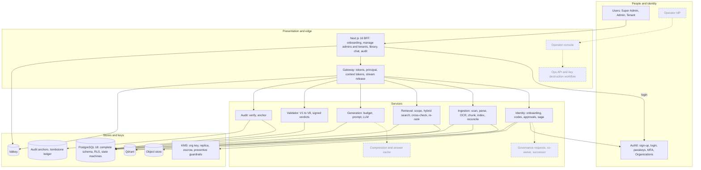
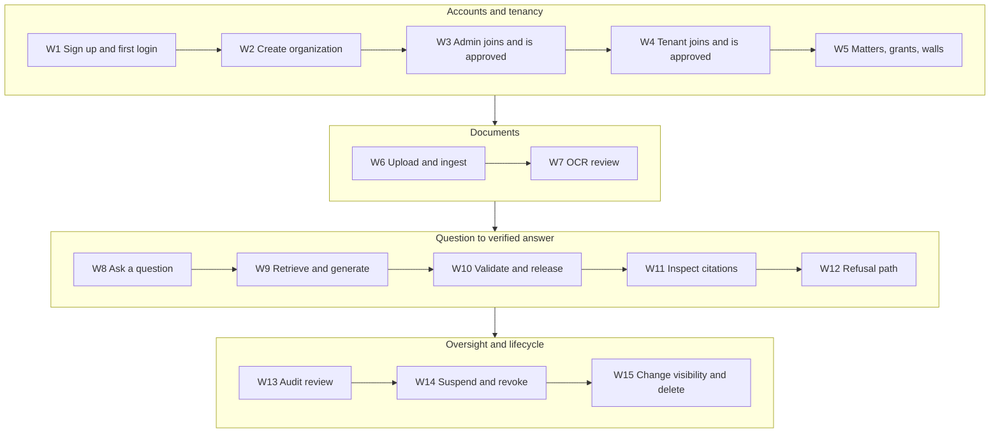
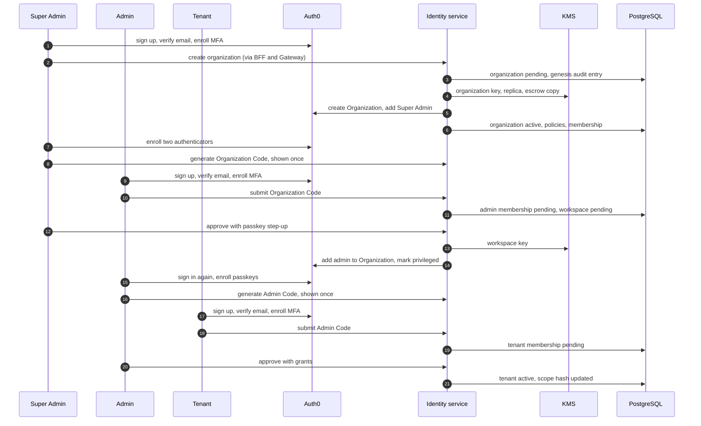
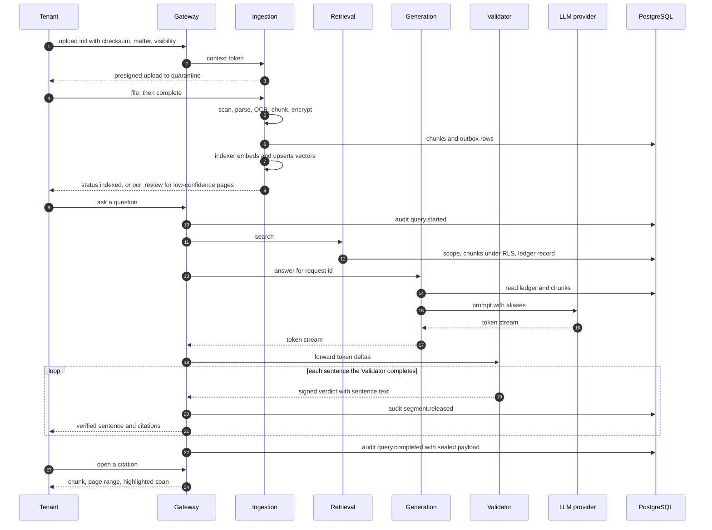
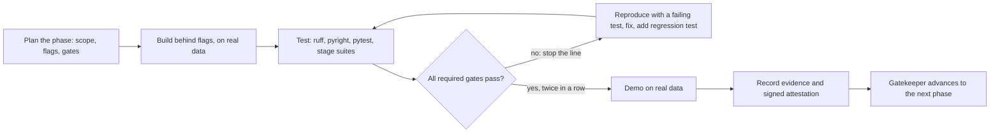
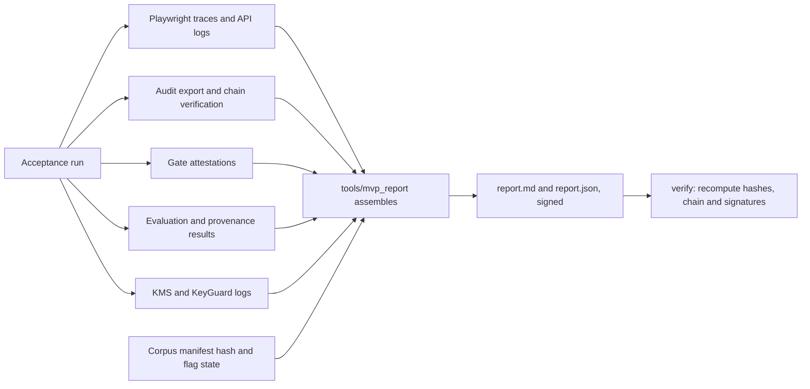
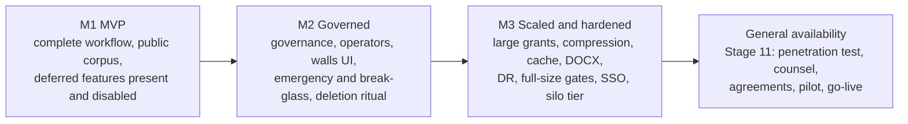

# MVP Prototype Report and Process — Legal/Medical Document Q&A System

**Version 1.0 · October 25, 2026 · Companion to the Master System Design v3.1**

*The MVP is release M1 of the real system. It is built in the same repository, on the same services, schema, contracts and gates as the final product, with real accounts, real documents and real providers. It contains no mock data and no throwaway code, and everything it does not yet include is present in the design as a disabled, gate-bound feature.*

## 0. Document control

| Item | Value |
| --- | --- |
| Purpose | Define the MVP: what it proves, what is in and out of scope, the complete end-to-end workflow, the real-data plan, the build process and gates, acceptance, the run report that evidences it, and how it grows into the final product |
| Relation to the master design | The MVP is a subset **by feature flag**, never by design. `Master §n` is a section of the Master System Design v3.1; `G#.#` is a gate defined there |
| Status | Plan. Nothing is built yet; every claim here is proven only by the gates it names |
| Conventions | `W#` workflow step, `N#` negative demonstration, `AC#` acceptance criterion, `C#` continuity rule, `P#` build phase, `MG#` MVP-specific gate, `MD#` open decision. Unprefixed "section n" refers to this document |
| What is not here | Application code, vendor contracts, customer data. The MVP never processes customer data (rule C10) |

## 1. Purpose and the continuity contract

### 1.1 Purpose

The MVP proves that the whole workflow works end to end on real documents with real identities: a person signs up through Auth0, an organization is created, an admin and tenants join and are approved, documents are ingested, a question is answered with sentence-level citations that were verified before release, and every step is audited, revocable and isolated. Every later release adds to this running system; nothing is rewritten.

### 1.2 What "not a different system" means

These ten rules are the continuity contract. A pull request that breaks one is rejected by the gatekeeper or in review.

| Rule | Statement | Enforced by |
| --- | --- | --- |
| C1 | **One repository, one layout.** The structure in Master §18 is used from the first commit. No `prototype/`, `mvp/`, `demo/` or `poc/` directory exists | Layout check in CI (MG3) |
| C2 | **One schema, additive migrations.** The full schema, RLS policies, state machines and key hierarchy exist in M1. Later releases only add; destructive migrations after the M1 tag are rejected | Migration lint (MG3) |
| C3 | **One set of service boundaries and ports** (Master §4.2). Deferred services are not deployed but keep their reserved ports, contracts and import boundaries | import-linter (G0.5) |
| C4 | **One contract set.** OpenAPI and `authz-matrix.yaml` list every endpoint; deferred endpoints are marked `enabled: false` and return 404 | G3.6, MG1 |
| C5 | **One identity model.** Real Auth0 tenants, the same roles, claims, passkeys for privileged roles and Actions as production | G0.7, G2.6, G2.7 |
| C6 | **One data lifecycle.** Organizations, documents, keys and audit chains created in M1 carry forward. Re-ingestion happens only through the designed re-embedding migration (G4.12) | MG3 |
| C7 | **No throwaway code.** Every merged line passes `ruff`, `pyright` and `pytest` at its stage. There is no demo mode, demo user, bypass of RLS, bypass of authentication or bypass of the validator | MG2 |
| C8 | **Flags are bound to gates.** A deferred feature is enabled only when its gate passes (section 8.4) | Gatekeeper, MG1 |
| C9 | **Shortcuts are recorded.** Every MVP simplification goes in the debt register with an owner, a flag or gate, and a target release. No shortcut may weaken a non-negotiable (section 1.3) | Review; run report section 9 |
| C10 | **No customer data.** M1 ingests only documents from the corpus manifest (public, licensed). Customer data enters only after the production gates in Master §20 Stage 11 | MG6, Master §19.1 rule R4 |

### 1.3 Non-negotiables that are never cut from the MVP

| Non-negotiable | Where it comes from |
| --- | --- |
| PostgreSQL row-level security is the final authority, with the complete access decision (grants, walls, tiers, private and matter visibility) | Master §5.4, §10.3 |
| The full key hierarchy, per-document keys, KMS guardrails and tombstone ledger | Master §12 |
| Hash-chained audit with hourly anchors, write-ahead before release, sealed payloads | Master §13 |
| Sentence-gated release: no unverified sentence ever reaches a user | Master §11.6 |
| Auth0 for all sign-up and login; passkeys or WebAuthn for Super Admins and admins | Master §8.4 |
| Fail closed on dependency failure | Master §3.1 principle 10, §10.4 |
| Real data only, no mocks, enforced by `ruff` bans | Master §19.1 |
| `ruff`, `pyright` and `pytest` as blocking, cumulative gates | Master §19 |

## 2. What the MVP must prove

| ID | Hypothesis | How it is proven |
| --- | --- | --- |
| H1 | The complete workflow, from sign-up to a verified cited answer and its audit trail, works on real data | AC1: the acceptance run of W1 to W15 |
| H2 | Isolation holds between organizations, workspaces, tenants and the Super Admin boundary | AC3: provenance-based isolation suite |
| H3 | Users can trust the answers: no unverified sentence is released and unanswerable questions are refused | AC4, AC5 |
| H4 | The pipeline works on real documents of the kinds customers have: long contracts, scanned pages, drug labels, case reports | AC5: structure fidelity, retrieval baselines, OCR quarantine |
| H5 | The system is operable: revocation is fast, failures are fail-closed, the audit trail verifies | AC6 |
| H6 | The MVP can grow into the final product without rework | AC8: continuity checks MG1 to MG3 and the expansion rehearsal in section 13.4 |

## 3. Scope

### 3.1 In and out, by capability

"Deferred" means designed, schema-complete, contract-listed, disabled by a flag and bound to a gate. It does not mean "removed".

| Area | In the MVP (real and complete) | Deferred (flag off, gate-bound) | Why deferral is safe |
| --- | --- | --- | --- |
| Identity and onboarding | Auth0 sign-up and login; the three onboarding paths; Organization Code and Admin Code; approvals; passkey enforcement; suspension and reactivation with cascade; real email | Co-owner, successor transfer, owner recovery, SSO connections | Schema, states and roles already exist; no MVP path depends on them |
| Governance | Step-up authentication and approvals for the actions in scope | The governance-request framework with two-person waits (`governance_requests`) | Needed only for actions that are themselves deferred |
| Access rules | The full decision function in the database; matters, grants with tier ceilings, private and matter documents; walls through the API | Walls UI, emergency access, break-glass reading of private documents | The policies already implement them; only entry points are off |
| Documents and ingestion | Upload, quarantine, malware scan, PDF text-layer, JATS and SPL XML, OCR with confidence and quarantine, structure-aware chunking, encryption, embedding, indexing, reconciler, deletion with crypto-erase | DOCX ingestion, quotas beyond basic caps | New format adds a parser behind an existing interface |
| Retrieval | Scoped hybrid search, Postgres cross-check, re-ranking, retrieval ledger | Over-fetch path for tenants with more than 256 grants (cap enforced with a clear error) | The cap is a configuration limit, not a design change |
| Generation | Token budget, trimming, prompt assembly with aliases, provider client, prompt registry, streaming | Compression, answer cache | Both are optimizations behind the same interface |
| Validation and delivery | Validator checks V1 to V8, signed verdicts, sentence-gated release, strip policy, write-ahead audit, resumable stream | Buffered mode with regeneration (needs no new design, only the `regenerate` policy value) | `strip` is the default policy; `regenerate` is configuration |
| Frontend | Onboarding, Manage Admins, Manage Tenants, library with upload and OCR review, chat with citation panel, audit, account | Governance center, walls UI, review queue beyond OCR, operator console | Pages call endpoints that already exist or are disabled |
| Audit and oversight | Audit service, chain and anchor verification, sealed payloads, five critical alerts, basic quotas | Full alert catalogue, hierarchical quotas, retention and legal hold | Data is already captured; later work adds views and policies |
| Keys and lifecycle | KMS key per organization, replica, escrow, preventive deletion guardrails and responder, tombstone ledger, document crypto-erase | Organization destruction ritual, sealing, workspace destroy, escrow restore drill | Preventive controls ship first because keys exist from day one |
| Operations | Operators are two named staff using cloud IAM with MFA and audit trails, on a non-production environment holding public data only | Operator plane with JIT access (`operator_plane`) | Customer data is not present, so standing operator access has nothing to expose |
| Infrastructure | Docker Compose on a single host plus real Auth0, KMS, S3 Object Lock, LLM provider, mailbox | Kubernetes, managed services, DR, canary deploys | Same container images and configuration |

### 3.2 Feature flags and gates

Flags live in `contracts/features.toml`, are read by the Gateway's route allow-list and the frontend's capability list, and are listed in Appendix B. The binding rule is in section 8.4. Policy and schema are never behind a flag; only entry points and UI are.

## 4. MVP architecture

The MVP is the master architecture with some boxes switched off. Solid boxes are built and gated; dashed boxes are designed and disabled.

### 4.1 Environments

| Environment | Purpose | Identity | Data |
| --- | --- | --- | --- |
| `dev` | Builders' daily work | Auth0 `dev` tenant, real sign-ups | Public corpus |
| `ci` | Gates and the acceptance run | Auth0 `ci` tenant, same Actions and policies, applied from code | Public corpus |
| `m1` | The MVP environment for demos, domain reviewers and the final acceptance run | Auth0 `staging` tenant | Public corpus, admitted only if listed in the manifest (MG6) |

All three use the same container images. Differences are configuration (hostnames, tenant IDs, budgets), listed in `.env.example` (Master Appendix C).

### 4.2 Real dependencies

| Dependency | Use in the MVP | Real or mocked |
| --- | --- | --- |
| Auth0 | All sign-up, login, passkeys, MFA, Organizations, Actions, Management API | Real tenants |
| Email | Verification, approval notices, code notices | Real mailboxes on a project-owned domain, read over IMAP in tests |
| AWS KMS | Organization keys, replica, escrow, trust root, signing | Real dev, CI and staging accounts |
| OpenBao | Immediate-shred tests only (KMS enforces a 7 to 30 day window) | Real software |
| S3 with Object Lock | Audit anchors, tombstone ledger | Real bucket |
| PostgreSQL, PgBouncer, Valkey, Qdrant, SeaweedFS, ClamAV | Stores and scanning | Real software in containers |
| Embedding, re-ranking and entailment models | Indexing, search, validation | Real models, self-hosted |
| LLM provider | Generation | Real provider with a spend cap; the corpus is public, so no confidential text leaves the boundary |
| Host | One machine, 16 or more vCPU and 64 GB RAM, GPU optional | Real; sizing confirmed in P0 |

## 5. The complete workflow

### 5.1 Overview

Fifteen steps cover the whole product, from the first sign-up to deleting a document. They run in order in the acceptance run (section 9) and each is traceable to the components and gates that prove it (Appendix A).

### 5.2 Step by step

Every step uses the real system and real data. "Evidence" is what the run report collects automatically (section 10).

| Step | Actor | What happens | Components (master reference) | Real data | Evidence | Gates |
| --- | --- | --- | --- | --- | --- | --- |
| W1 Sign up and first login | Any person | Auth0 sign-up; email verified from a real mailbox; MFA enrolled; the first token carries the onboarding scope only | Auth0, BFF, Gateway (Master §7.1, §8) | Real identity, project-owned mailbox | Auth0 log, onboarding status, audit login event | G0.7, G2.7, G3.1 |
| W2 Create organization | Super Admin | Name, deployment type (legal or medical) and region; the saga creates the organization key, replica and escrow copy, the Auth0 Organization and default policies; the Super Admin enrolls two authenticators and generates the Organization Code, shown once | Identity, KMS, Auth0, PostgreSQL (Master §7.2, §12) | Real KMS keys and Auth0 Organization | Saga step log, key aliases, audit events, code lookup ID | G2.1, G2.2, G2.5, G2.6 |
| W3 Admin joins and is approved | Admin, Super Admin | The admin signs up and submits the Organization Code; the request is pending with no access; the Super Admin approves with passkey step-up; the workspace is provisioned; the admin enrolls passkeys and generates the Admin Code | Identity, Auth0, KMS (Master §7.3) | Second real identity | State transitions, Auth0 membership, workspace key row | G2.3, G2.8, G2.9, G3.2 |
| W4 Tenant joins and is approved | Tenant, Admin | The tenant signs up, previews the workspace, submits the Admin Code; the admin approves | Identity (Master §7.4) | Third real identity | Pending then active, scope hash created | G2.4, G2.5 |
| W5 Matters, grants, walls | Admin | The admin creates matters (legal: by contract family; medical: by case collection), grants tenants access with tier ceilings, and can create a wall through the API | Workspace API, PostgreSQL (Master §5.4 to §5.6) | | Grant and wall rows, scope-hash change | G5.5, G5.6 |
| W6 Upload and ingest | Admin, Tenant | Real documents are uploaded; quarantine, malware scan, parse, OCR, chunking, encryption, embedding, indexing; status is visible | Ingestion, object store, Qdrant, models (Master §11.1) | Corpus-manifest documents | Document states, chunk counts, index state, job log | G4.1 to G4.12 |
| W7 OCR review | Owner, Admin | Pages below the confidence threshold are quarantined and never embedded; the owner compares page image and text, approves or corrects, and the new version is indexed | Ingestion, frontend (Master §11.1) | Real scanned documents | Version with `text_source`, zero quarantined chunks in the index | G4.5, G8.3 |
| W8 Ask a question | Tenant | The question is sent in chat, optionally narrowed to granted matters; the stream opens after the write-ahead audit event | Frontend, Gateway (Master §4.4) | Real questions from published sets | `query.started` event | G3.6, G7.9 |
| W9 Retrieve and generate | System | Scope is resolved from the database; hybrid search; Postgres cross-check; re-ranking; ledger record; token budget; prompt with aliases; the real model streams | Retrieval, Generation (Master §11.3 to §11.5) | Real chunks, real LLM | Retrieval record, token counts, prompt hash | G5.1 to G5.6, G6.1 to G6.10 |
| W10 Validate and release | System | The Validator segments the stream, runs V1 to V8 and signs each verdict; the Gateway releases only sentences with a passing verdict; a failing sentence is replaced by a visible marker | Validator, Gateway (Master §11.6) | | Signed verdicts, `segment.released` events | G7.1 to G7.9 |
| W11 Inspect citations | Tenant | A marker opens the source chunk, page range and highlighted span; visibility is re-checked | Frontend, citations endpoint (Master §11.2) | | Resolved citation record | G7.10, G8.9 |
| W12 Refusal path | Tenant | A question the documents cannot answer yields the canonical refusal and no unsupported claim | Generation, Validator | Reviewer-labeled unanswerable questions | Refusal verdict | G6.7, G7.1 |
| W13 Audit review | Tenant, Admin, Super Admin | A tenant sees own history, the admin the workspace, the Super Admin org-level events only; the chain and anchors verify | Audit (Master §13) | | Verified chain and anchor | G9.1, G9.2 |
| W14 Suspend and revoke | Admin, Super Admin | The admin suspends a tenant: a still-valid token is rejected within 2 seconds and an open stream is cut. The Super Admin suspends an admin: the workspace freezes and tenants are suspended with reason `workspace_frozen`; reactivation restores only cascade-suspended tenants | Identity, Gateway, Valkey (Master §8.6) | | Timings, audit events | G3.4, G2.8, G2.12 |
| W15 Change visibility and delete | Owner, Admin | A private document becomes matter-visible and the outbox re-indexes it; deleting destroys the document key, makes chunk text unreadable, removes vectors and the object, and writes a tombstone | Ingestion, keys (Master §10.6, §12.9) | | Outbox latency, reconciler result, tombstone entry | G4.10, G4.11, G1.11 |

### 5.3 Accounts and tenancy (W1 to W5)

### 5.4 Documents to a verified answer (W6 to W12)

### 5.5 Negative demonstrations

The acceptance run also performs real attempts that must fail. They use real accounts and real documents; nothing is simulated.

| ID | Real attempt | Expected result | Gates |
| --- | --- | --- | --- |
| N1 | Admin B requests Admin A's document by ID, by search and by download | 404; no foreign hash in any output | G5.4 |
| N2 | The Super Admin calls the query and document routes; SQL as the `super_admin` role on content tables | 404; zero rows | G3.6, G1.5 |
| N3 | A tenant requests another tenant's private document, including inside a shared matter | 404 | G1.4, G5.6 |
| N4 | A suspended tenant uses a still-valid token and an open stream | Rejected within 2 s; stream cut | G3.4 |
| N5 | A pending admin requests an organization-scoped token | Refused | G2.3 |
| N6 | Wrong, expired, rotated and over-used codes | Identical responses; limits trigger | G2.5 |
| N7 | An unanswerable question | Canonical refusal | G6.7 |
| N8 | The Validator runs on human-labeled unsupported pairs | Rejected at the calibrated rate | G7.3 |
| N9 | An ordinary role tries to schedule deletion of an organization key; a drill key is scheduled without approval | Access denied; automatic cancel within 60 s | G1.12, G9.12 |
| N10 | A deleted document is decrypted and searched for | Undecryptable; no hits | G4.11 |
| N11 | A walled tenant queries the walled matter, including their own documents in it | Nothing returned | G5.5 |

### 5.6 Legal and medical on one code path

The two deployment types differ only in configuration and data.

| Aspect | Legal organization | Medical organization |
| --- | --- | --- |
| Deployment type | `legal` | `medical` |
| Documents | Contracts, court opinions, statutes and rules | Case reports, drug labels, guidelines |
| Matter scope | Contract family or case group | Case collection or label group |
| Structure detection | Articles, sections, clauses, schedules | JATS sections, SPL sections, headings |
| Critical tokens checked by V5 | Amounts, dates, section and statute references | Doses with units, dates, lab values |
| Answer cache | Allowed (off in M1) | Off by default |
| Emergency access | Not available | Deferred (`emergency_access`) |
| Example question | "What law governs this agreement?" | "What is the maximum recommended daily dose?" |

## 6. Real-data plan

### 6.1 Rules

All ten real-data rules of Master §19.1 apply unchanged. The MVP adds four practical measures:

1. **Manifest allow-list (MG6).** In every environment except production, the upload API admits only files whose SHA-256 appears in `corpus/manifest.toml`. Customer files cannot enter by accident (C10). The production profile requires the allow-list to be off and requires the Stage 11 evidence first.
2. **No seeding path.** `lmqa_testing` has no SQL seeding helper. The corpus enters through the product's own APIs, uploaded by real accounts, so ownership, keys, audit and visibility are created by the real code.
3. **Named owners.** Each of the 14 identities belongs to a named person who controls the mailbox and authenticators.
4. **Listed controls only.** Negative controls (the EICAR test file, planted secrets, crafted malformed tokens, adversarial strings from public datasets) appear only in `tests/controls.md`.

### 6.2 Corpus profile for M1

The M1 profile is smaller than the full profile in Master Appendix B and larger than anything needed to make the workflow work. Every item records URL, licence, retrieval date and SHA-256, and licences are reviewed before use (G0.8).

| Domain | Category | Count | Formats | Candidate sources (verify each licence) |
| --- | --- | --- | --- | --- |
| Legal | Commercial contracts | 55 | PDF, sanitized HTML | SEC EDGAR exhibits (30); the CUAD annotated contracts (25) |
| Legal | Court opinions | 10 | PDF | CourtListener, Caselaw Access Project |
| Legal | Statutes and rules | 5 | PDF, XML | govinfo.gov, HIPAA rules (45 CFR 160 and 164) |
| Legal | Real scanned multi-page documents | 10 | Scanned PDF | Public-domain archives |
| Medical | Case reports | 40 | JATS XML plus PDF | PubMed Central open-access subset, permissive licences only |
| Medical | Drug labels | 20 | SPL XML | DailyMed |
| Medical | Guidelines and trial records | 10 | PDF, records | Agency guidelines where the licence allows; ClinicalTrials.gov |
| Medical | Real scanned documents | 5 | Scanned PDF | Public-domain archives |
| Both | Rasterized real pages (exact OCR ground truth) | 20 sets | Image PDF | Pages from the documents above, rasterized with scanner-like transformations |
| Both | Long documents (100+ pages) | at least 3 | PDF | Credit agreements, regulatory parts |

M1 profile minimum for G0.8: 60 legal, 60 medical, 10 scanned multi-page, 3 documents of 100 pages or more. DOCX is excluded (`docx_ingest` is deferred).

### 6.3 Organizations and identities

Two organizations make the isolation tests meaningful and exercise both deployment types. Each of the 14 identities is a real Auth0 user with its own mailbox.

| Organization | Super Admin | Workspace and admin | Tenants | Documents |
| --- | --- | --- | --- | --- |
| Org L (legal) | L0 | Corporate contracts: admin L1 | L1a, L1b | Contracts, scanned contracts |
| Org L (legal) | | Case law and regulations: admin L2 | L2a, L2b | Opinions, statutes, rules |
| Org M (medical) | M0 | Case reports: admin M1 | M1a, M1b | Case reports, scanned documents |
| Org M (medical) | | Drug labels and guidelines: admin M2 | M2a, M2b | Labels, guidelines, trial records |

Matters group documents by real attributes (contract family, court, specialty, drug class). Automated runs, including the acceptance run in every environment, use Chromium virtual authenticators; when the domain reviewers work in `m1` they use real platform passkeys and security keys. Each acceptance run creates fresh identities from owner-controlled mailbox aliases and deletes them through the Management API after the report is signed, so repeated runs start clean while every identity still traces to a named person.

### 6.4 Questions and labels

| Set | Size | Source | Used for |
| --- | --- | --- | --- |
| Legal answerable questions | 60 | Published contract question-answering annotations with expert-marked spans, kept only if the source contract is in the corpus | Retrieval baseline, W9 to W11 |
| Medical answerable questions | 60 | Published biomedical question-answering items and label questions (doses, contraindications) whose answers a qualified reviewer verified in the loaded documents | Same |
| Unanswerable questions | 20 per domain | Written by a qualified attorney or clinician from the same documents, answer absent | W12, N7 |
| Human-labeled sentence and chunk pairs | 100 per domain | Labeled by a qualified attorney and a clinician, held out from tuning | Validator calibration, N8 |
| Injection strings | public set | Public datasets, embedded into real documents as controls | G6.6 |

Items whose source documents are not in the corpus are dropped, never rewritten or invented. The reviewer's name and the date are recorded for each label (R10).

### 6.5 Gaps stated honestly

- Real clinical notes in SOAP form are not available under a clean public licence; the medical corpus uses case reports and labels. Real notes arrive only through a credentialed lane or a pilot under a BAA.
- The corpus is English only, small compared with a customer's, and contains no real privilege or PHI. Scale is tested later by replicating real documents (Master §19.1, R8).
- Real customer document formats and quirks are unknown until a pilot.

### 6.6 How data enters the system

`tools/load_corpus` logs in as the named identities through the Auth0 harness, uploads each manifest document through the upload API into the right workspace, and polls status until `indexed` or `ocr_review`. It records counts, durations and failures to the run report. Re-running it creates no duplicates (G4.7).

## 7. Build process

### 7.1 The operating loop

Every phase repeats the same loop. Nothing advances on a failed gate, and a failure is fixed in the phase where it was found.

### 7.2 Phases

The MVP maps onto the twelve stages of the master design with a reduced profile. Durations are planning estimates (section 14) to be re-baselined at the end of P0.

| Phase | Master stage | Indicative weeks | MVP scope | Exit demo |
| --- | --- | --- | --- | --- |
| P0 Foundation | 0 | 1 to 3 | Everything in Stage 0, with the M1 corpus profile | `make doctor` green; a real sign-up through the harness; the corpus loaded and hash-verified; the queue spike result |
| P1 Data layer and keys | 1 | 4 to 6 | Everything in Stage 1 | The policy-versus-oracle run; document shredding on OpenBao and the KMS schedule, cancel and re-enable path; a key-deletion attempt refused; audit tamper detected |
| P2 Identity and gateway | 2 and 3 | 7 to 11 | Stage 2 without governance requests; all of Stage 3 | W1 to W5 through the API; token abuse suite; revocation timing run |
| P3 Ingestion | 4 | 10 to 13 | Everything in Stage 4 at M1 sizes | W6 and W7 on the real corpus including scanned documents; drift repaired by the reconciler |
| P4 Retrieval, generation, validation | 5, 6, 7 | 12 to 18 | Stage 5 without emergency access and large grants; Stage 6 without compression and cache; all of Stage 7 | W8 to W12 through the API with the real model; a captured stream proving gated release |
| P5 Frontend, audit, alerts | 8 and 9 (subset) | 15 to 21 | Minimal real UI; audit verification and sealing; five critical alerts; basic quotas | All 15 workflow steps by domain reviewers in a browser |
| P6 Acceptance and run report | 10 (subset) | 21 to 24 | Isolation suite, fuzz, chaos subset, security scans, baselines, run report | Three consecutive green acceptance runs; the signed M1 release |

### 7.3 Phase detail

**P0 Foundation.** Build the repository skeleton, `uv` workspace, CI, `stages.toml` and the gatekeeper with the `mvp` profile, import-linter contracts, Compose infrastructure, Auth0 `dev`, `ci` and `staging` tenants as code, `tools/auth_harness`, AWS KMS and S3 Object Lock buckets with OIDC for CI, corpus manifest and fetchers with licence review, OpenAPI skeletons that already list deferred endpoints as disabled, `contracts/features.toml`, ADRs 0001 to 0012, and the queue and connection-routing spike. Start recruiting the domain reviewers now, because label quality sets the schedule.
*Gates:* G0.1 to G0.13 (G0.8 under the M1 profile).

**P1 Data layer and keys.** Schema, roles, FORCE RLS, helper functions, boot self-test, scoped session, transition tables generated from `state-machines.yaml`, audit chain and anchors, key providers, envelope encryption, KeyGuard preventive controls and responder, outbox, tombstone ledger. The schema is complete here (C2).
*Gates:* G1.1 to G1.12.

**P2 Identity and gateway.** Identity service with the three onboarding paths, codes, approvals, saga, Auth0 sync and revocation fan-out; Gateway with token verification, principal view, context tokens with certified signer keys, allow-list from the authorization matrix, rate limits, idempotency, step-up.
*Gates:* G2.1 to G2.7, G2.11, G2.12; G2.8 and G2.9 for the included lifecycles; G3.1 to G3.10. Deferred: G2.10.

**P3 Ingestion.** Upload, quarantine, scan, parsers for PDF, JATS and SPL, OCR with confidence and quarantine, structure detection, chunker, encryption, workers with fair-share, indexer, reconciler, deletion and holding queue. Parser bake-off report.
*Gates:* G4.1, G4.2, G4.5 to G4.7, G4.9 to G4.11; G4.3, G4.4, G4.8, G4.12 at M1 sizes.

**P4 Retrieval, generation, validation.** Vector wrapper and read-only credentials, scope resolver, hybrid search, cross-check, re-ranking, ledger; token budget, trimming, prompt assembly, provider client, registry; validator, segmentation, entailment calibration, signed verdicts, release in the Gateway, write-ahead audit, resume buffer.
*Gates:* G5.1 to G5.6, G5.8, G5.10 to G5.12; G6.1, G6.2, G6.4, G6.6 to G6.10; G7.1 to G7.12 at M1 sizes (G7.8 for the strip policy). Deferred: G5.7, G5.9, G6.3, G6.5, and the regenerate policy.

**P5 Frontend, audit, alerts.** Next.js 16 pages for the in-scope routes, generated API client, CSP with nonces, server-side sessions; audit service with verification and sealing; five critical alerts from the master catalogue (Master §13.6) each triggered for real: failed audit-chain or anchor verification, a key scheduled-deletion or key-policy event, a boot self-test or role-attribute failure, a write rejected by a database policy, and an admin role assigned outside an approved membership; basic per-workspace rate and storage caps.
*Gates:* G8.1, G8.2, G8.4 to G8.10; G8.3 for admin, tenant and OCR review flows; G9.1, G9.2; G9.3 for the five alerts; G9.9 for the included machines; G9.12 without the escrow restore drill.

**P6 Acceptance and run report.** Cumulative re-run, MVP isolation suite, fuzz, chaos subset, security scans and SBOM, baseline floors, then the acceptance run three times and the run report.
*Gates:* G10.1 to G10.3, G10.5 to G10.7; G10.4 and G10.9 as baselines; MG1 to MG6.

### 7.4 Parallel streams

| Stream | Can start after | Notes |
| --- | --- | --- |
| Corpus licensing and manifest | Day 1 | Gates G0.8; legal review runs in parallel with engineering |
| Domain reviewers and labels | Day 1 | Questions, unanswerable questions and 100 sentence pairs per domain are needed by P4 |
| Auth0 tenants and Actions as code | P0 | Used by every later phase |
| Frontend | The generated client (G0.10) and the Gateway (P2) | Builds against real endpoints, not stubs |
| Run-report tool | P2 | Grows with each phase so the report exists long before P6 |
| Load baseline | P4 | Recorded, not gated |

### 7.5 Definition of done for a phase

1. Every required gate passes on a clean CI run twice in a row, with zero skips outside the listed platform markers and zero waivers.
2. The gate attestation is signed and stored; the gatekeeper advances `STAGE`.
3. The demo was run on real data and recorded.
4. The debt register and ADRs are current.
5. No flag was enabled without its gate (section 8.4).

## 8. Quality gates for the MVP

### 8.1 Tooling

The MVP uses the same `ruff`, `pyright` and `pytest` configuration as the master design (Master §19.3 and §19.4), including the banned-import rules that enforce the no-mocks and no-fake-data policy. `make gate STAGE=n PROFILE=mvp` selects the M1 profile in `stages.toml`: the list of required gates, M1-sized corpora and sample counts. The attestation records the profile. The `full` profile is required for general availability.

The profile may reduce **sizes and feature scope only**. Safety thresholds are identical in both profiles: zero cross-scope leaks, zero unverified sentences, validator precision 0.99 or better, revocation within 2 seconds at p99, fail-closed behavior.

### 8.2 Gate matrix

| Master stage | Required in M1 | M1 profile (smaller size or subset) | Deferred (flag-bound) |
| --- | --- | --- | --- |
| 0 | G0.1 to G0.7, G0.9 to G0.13 | G0.8 (M1 corpus profile) | none |
| 1 | G1.1 to G1.12 | none | none |
| 2 | G2.1 to G2.7, G2.11, G2.12 | G2.8, G2.9 (included lifecycles) | G2.10 |
| 3 | G3.1 to G3.10 | none | none |
| 4 | G4.1, G4.2, G4.5 to G4.7, G4.9 to G4.11 | G4.3 (100 chunks), G4.4, G4.8, G4.12 (M1 sizes) | none |
| 5 | G5.1, G5.2, G5.4 to G5.6, G5.8, G5.10 to G5.12 | G5.3 (baseline set, floors created) | G5.7, G5.9 |
| 6 | G6.1, G6.2, G6.4, G6.6 to G6.10 | none | G6.3, G6.5 |
| 7 | G7.1, G7.2, G7.4 to G7.6, G7.9 to G7.11 | G7.3 (100 pairs per domain), G7.7 (320 live queries), G7.8 (strip policy only), G7.12 (8 s p95 target) | regenerate policy (`delivery_regenerate`) |
| 8 | G8.1, G8.2, G8.4 to G8.10 | G8.3 (admin, tenant, OCR review flows) | walls, governance and review-queue UI |
| 9 | G9.1, G9.2 | G9.3 (five alerts), G9.9 (included machines), G9.12 (no escrow restore drill) | G9.4 to G9.8, G9.10, G9.11 |
| 10 | G10.1 to G10.3, G10.5 to G10.7 | G10.4 (baseline only), G10.9 (SBOM and signing) | G10.8, G10.10 |
| 11 | none | none | all |

### 8.3 MVP-specific gates

| Gate | Check | Pass criterion |
| --- | --- | --- |
| MG1 | Flag registry | Every deferred feature has a flag in `contracts/features.toml`, its endpoints are listed as disabled and return 404, and every flag names its bound gates (Appendix B) |
| MG2 | No demo path | A scan finds no demo mode, demo user, seeded SQL, bypass setting, fixture outside the corpus manifest and `tests/controls.md`, or banned import |
| MG3 | Continuity | The layout check finds no `prototype`, `mvp`, `demo` or `poc` directory; migrations after the M1 tag are additive only; documents, keys and audit chains created in M1 verify under the next release |
| MG4 | Acceptance run | Three consecutive passing runs on a clean `m1` environment (section 9) |
| MG5 | Run report | The report is generated from system data and `verify` reproduces every number and hash (section 10) |
| MG6 | Data admission | Every document, chunk and object in `m1` traces to a manifest entry; the upload API refuses files not in the manifest; the production profile lint requires the allow-list off only with Stage 11 evidence |

### 8.4 Binding a flag to its gates

A flag may be set to `true` outside a test environment only when:

1. its bound gates (Appendix B) have run on the commit with the flag on in `ci`, with signed attestations;
2. the cumulative gates still pass with the flag on;
3. the gatekeeper finds the attestations and allows the default to change in `features.toml`.

Setting a flag in any environment without those attestations fails the gatekeeper's check (MG1). This is how the MVP becomes the final product without rework: each deferred capability arrives as a gated change to the same system.

## 9. Acceptance

### 9.1 Acceptance criteria

| ID | Criterion | Measure |
| --- | --- | --- |
| AC1 | Workflow completeness | W1 to W15 and N1 to N11 pass in one unattended run; three consecutive runs on fresh organizations |
| AC2 | Gates | All required and M1-profile gates in section 8.2 and MG1 to MG6 pass; `ruff` zero findings; `pyright` clean; `pytest` zero failures, zero unlisted skips |
| AC3 | Isolation | The provenance suite finds zero foreign identifiers or content hashes in any output channel across both organizations, four workspaces and eight tenants |
| AC4 | Verified release | Zero unverified sentences across at least 320 live queries (every question asked by both tenants of the owning workspace) |
| AC5 | Quality baselines | 100% chunk fidelity (G4.2); 100% of below-threshold pages quarantined; retrieval baselines and floors recorded for both domains; validator precision at least 0.99 on the 100-pair labeled sets; refusal rate and false-refusal rate recorded |
| AC6 | Operability | Revocation p99 within 2 s over at least 200 trials; fail-closed behavior with audit, Valkey and Qdrant each taken down; time to first verified sentence p95 within 8 s on the `m1` host (the final target is 6 s) |
| AC7 | Evidence | The run report exists, is signed and verifies |
| AC8 | Continuity | MG1 to MG3 pass; the expansion rehearsal (section 13.4) passes |

### 9.2 The acceptance run

| Step | Action | Notes |
| --- | --- | --- |
| 1 | Build `m1` from code; run `make doctor` | Real Auth0 `staging`, KMS, buckets, provider |
| 2 | Create two new organizations, four workspaces, eight tenants through the real flows (W1 to W5) | Run-specific names, so each run proves repeatability |
| 3 | Load the corpus through the upload API (W6, W7) | Records durations, counts, quarantine and review results |
| 4 | Ask all 160 questions from both tenants of the owning workspace (W8 to W12) | 320 live queries; a sample is driven through the browser, the rest through the API |
| 5 | Run N1 to N11 | Real attempts against the live system |
| 6 | Run W13 to W15 | Audit review, suspension and revocation timing, visibility change, deletion |
| 7 | Fault injection | Kill the audit database mid-stream; stop Valkey; stop Qdrant; confirm fail-closed behavior |
| 8 | Collect evidence and generate the report | Section 10 |
| 9 | Repeat steps 1 to 8 twice more on fresh environments | Three consecutive passes required |

### 9.3 Pass and fail rules

A single failed check fails the run. A run is never retried to obtain a green result: the failure is investigated, the cause fixed with a regression test, and a new run starts from step 1. Failed runs stay in the report history. The release is signed only after three consecutive passing runs at one commit and a review of the answer samples by the attorney and clinician reviewers (they inspect at least 30 released answers per domain, including all stripped sentences, and record acceptable or not).

## 10. The MVP run report

### 10.1 Purpose

The run report is the MVP's proof. It shows the complete workflow as it happened, built only from data the system itself produced, so a reader can verify it rather than trust it.

### 10.2 How it is produced

### 10.3 Structure

| Section | Content | Source |
| --- | --- | --- |
| 1 Run header | Run ID, commit, tool versions (`ruff`, `pyright`, `pytest`, Python), environment, time window, config hashes, corpus manifest hash, feature-flag state | Build metadata |
| 2 Workflow trace | W1 to W15: start and end time, request IDs, result, links to audit events and browser traces | Playwright, audit service |
| 3 Negative demonstrations | N1 to N11: the exact attempt, status and response hash | API logs |
| 4 Isolation | Provenance results by group: outputs scanned, hits found (must be 0) | Leak scanner |
| 5 Gate attestations | Each required gate: ID, result, attestation reference | Signed attestations |
| 6 Quality | Chunk fidelity, OCR metrics, retrieval baselines, validator precision and recall, refusal rates, token-count agreement, latency percentiles, revocation timings | Evaluation harness, k6 baseline |
| 7 Audit and keys | Chain and anchor verification, key operations from the cloud audit log and KeyGuard, escrow status | Audit service, CloudTrail |
| 8 Failure behavior | Fault-injection results | Chaos suite |
| 9 Deviations | Debt-register entries, deferred features with their flags and gates, waivers (none allowed) | Registers |
| 10 Verification | Hashes of every input, signature, and the command that re-verifies the report | Generator |

### 10.4 Rules

1. **Generated, never typed.** Every number carries its source query or file; the generator refuses to emit a figure it cannot trace.
2. **Failures included.** Failed checks and failed earlier runs appear in the history.
3. **Content-free.** The report holds identifiers, hashes and public document titles from the manifest, never document text or personal data.
4. **Reproducible.** `tools/mvp_report verify <run-id>` recomputes hashes, re-verifies the audit chain and anchors, and checks signatures from stored artifacts.
5. **Versioned and retained** with the release tag.

## 11. Roles, cadence and change control

### 11.1 Roles

| Role | Responsibility |
| --- | --- |
| Product owner | Scope, acceptance sign-off, flag decisions |
| Tech lead | Architecture conformance, ADRs, gatekeeper ownership |
| Security lead | Review of `db/policies/`, key controls, authorization matrix, isolation suite; owns incident reviews |
| QA and automation lead | Acceptance run, Playwright and provenance tooling, run report |
| Data steward | Corpus manifest, licences, allow-list |
| Domain reviewers (an attorney and a clinician) | Question sets, unanswerable questions, 100 labeled sentence pairs per domain, review of released answers |
| Release manager | Runs the gatekeeper, signs attestations, cuts the M1 tag |

### 11.2 Cadence

- **Weekly gate review:** current phase status, failing gates, debt-register changes, risk review.
- **Phase-end demo** on real data, recorded and attached to the phase evidence.
- **Failure review** within two working days of any failure in an isolation, authentication, key or audit gate, recorded as an ADR addendum (the design claim may have been wrong, not only the code).
- **Release review** before the M1 tag: acceptance results, run report, sign-offs.

### 11.3 Change control

Any change to a master-design decision needs an ADR. Any shortcut goes into the debt register below before the code merges. No change may lower a safety threshold, remove a non-negotiable (section 1.3) or add a path around RLS, authentication, the validator or the audit write.

### 11.4 Initial debt register

| ID | Shortcut | Why acceptable in M1 | Flag or gate | Target | Owner |
| --- | --- | --- | --- | --- | --- |
| DR-1 | Operators are two named staff using cloud IAM with MFA and audit trails | M1 holds public data only | `operator_plane`, G9.7 | M2 | Security lead |
| DR-2 | Tenants are capped at 256 grants | Configuration limit with a clear error | `large_grant_path`, G5.9 | M3 | Tech lead |
| DR-3 | Only `sentence_gated` delivery with the `strip` policy | Default policy; regeneration is a policy value | `delivery_regenerate`, G7.8 | M2 | Tech lead |
| DR-4 | No compression and no answer cache | Optimizations behind existing interfaces | `compression`, `answer_cache`, G6.3, G6.5 | M3 | Tech lead |
| DR-5 | One host, no high availability, no disaster-recovery drill | No customer data | G9.10, Stage 11 | M3 | Release manager |
| DR-6 | Validator calibration on 100 pairs per domain | Precision floor is unchanged; the sample is smaller | G7.3 full | M3 | Domain reviewers |
| DR-7 | 320 live queries for the gated-release proof, not 1,000 | Zero-leak criterion is unchanged | G7.7 full | M3 | QA lead |
| DR-8 | Five critical alerts only | Remaining alerts cover deferred features | G9.3 full | M2 | Security lead |
| DR-9 | Basic per-workspace caps instead of hierarchical quotas | Single organization scale | `quotas_hierarchical`, G9.4 | M2 | Tech lead |
| DR-10 | No DOCX ingestion | PDF, JATS and SPL cover the corpus | `docx_ingest` | M3 | Tech lead |
| DR-11 | No governance, walls or review-queue UI | API and policies exist | `walls_ui`, `governance_requests` | M2 | Product owner |
| DR-12 | Time-to-first-verified-sentence target 8 s | CPU models on one host | G7.12 at 6 s | M3 | Tech lead |

## 12. Risks

| ID | Risk | Mitigation | Early signal |
| --- | --- | --- | --- |
| K1 | Auth0 login automation or rate limits slow or break CI | Virtual authenticators, a dedicated paid `ci` tenant, session-scoped logins with refresh rotation | More than 2 percent login failures in CI |
| K2 | The queue spike fails against the pooler | Fallback to Celery recorded in ADR 0011 | G0.13 red at the end of P0 |
| K3 | Domain reviewers are late, so labels are late | Book reviewers in week 1 with four hours a week each; labels are due before P4 | Label set under 50 percent at the start of P4 |
| K4 | Licence review excludes corpus items | Keep a 20 percent buffer in the manifest; drop rather than substitute invented content | G0.8 below the profile minimum |
| K5 | Real scans produce many low-confidence pages, so the review queue grows | OCR bake-off, tuned thresholds, reviewer capacity, quarantine share tracked | Quarantined page share above 15 percent |
| K6 | Live LLM cost or rate limits during repeated acceptance runs | Spend caps, separate PR and nightly lanes, recorded responses only in the fast lane | Spend above 80 percent of the cap |
| K7 | Scope creep: deferred features pulled in, or non-negotiables cut under schedule pressure | Continuity contract, gatekeeper, debt register, weekly review | Flags enabled without attestations |
| K8 | A demo shortcut appears (demo mode, seeded data) | MG2 scan, `ruff` bans | Any new "demo" identifier |
| K9 | CPU-only models miss the latency target | Measure in P4; GPU optional; smaller entailment model; sentence batching | Time to first sentence over 8 s |
| K10 | Customer data enters `m1` | MG6 allow-list, no customer uploads accepted | Any non-manifest hash rejected (a signal, not a failure) |
| K11 | Dependency and vendor drift (Next.js security releases, Qdrant minors) | Adoption policy and cooldown (Master §4.5); pinned digests | Open security advisory older than its window |
| K12 | The entailment model cannot reach precision 0.99 | Tighten the threshold and accept more stripping; improve the model; add deterministic checks. The floor is never lowered | G7.3 below floor after two iterations |
| K13 | Estimates are wrong | Re-baseline at the end of P0 with spike and reference-host results | P0 overrun beyond one week |

## 13. Expansion path

### 13.1 Releases

| Release | Adds (flags turned on) | Gates that must pass first | Customer data |
| --- | --- | --- | --- |
| M1 | None beyond scope (section 3) | Section 8.2 and MG1 to MG6 | Never |
| M2 Governed | `governance_requests`, `co_owner`, `successor_transfer`, `owner_recovery`, `break_glass_private_read`, `emergency_access`, `walls_ui`, `operator_plane`, `org_deletion_ritual`, `legal_hold_retention`, `quotas_hierarchical`, `delivery_regenerate` | G2.10, G5.7, G7.8 (full), G9.3 (full), G9.4 to G9.9, G9.11, G9.12 (full) | Not yet |
| M3 Scaled and hardened | `large_grant_path`, `compression`, `answer_cache`, `docx_ingest`, `collection_per_workspace`, `sso_connections`; the `full` gate profile | G5.9, G6.3, G6.5, full-size G0.8, G7.3, G7.7, G9.10, G10.4, G10.8, G10.10 | Not yet |
| GA | Production profile | G11.1 to G11.10 | Only after G11.4 and G11.5 |

### 13.2 What never changes between releases

Service names, ports and boundaries; the `/v1` API paths; the database schema except by additive migration; the key hierarchy and IDs; audit chains and anchors; the corpus and the documents already ingested; the Auth0 tenants' configuration model; the gate definitions. M1 organizations, documents and keys carry forward. The `m1` environment becomes the staging environment of later releases.

### 13.3 Turning on a deferred feature

Follow section 8.4. In practice: implement behind the flag; add or enable the bound gate tests; run the cumulative gates with the flag on in `ci`; let the gatekeeper accept the attestations; change the default; add the feature to the next run report's "enabled features" list; close the debt-register entry.

### 13.4 Expansion rehearsal

Before the M1 tag, the acceptance run proves the system can grow without rework:

| Check | Procedure | Pass criterion |
| --- | --- | --- |
| ER1 | Set a deferred flag in `ci` without attestations | The gatekeeper refuses |
| ER2 | Apply an additive migration on top of M1 data | M1 organizations, documents, keys and audit chains still verify and answer queries |
| ER3 | Run a re-embedding migration (new collection, alias swap) on M1 documents | No downtime, same answers within the retrieval floor, no re-upload |
| ER4 | Call every deferred endpoint | 404 from the authorization matrix, not a missing route |
| ER5 | Re-run the cumulative gates after ER2 and ER3 | All pass |

## 14. Planning estimates and open decisions

### 14.1 Assumptions

One tech lead, three backend and ML engineers, one frontend engineer, half a security engineer, half a QA and automation engineer, a quarter of a product owner and a quarter of a data steward early on, plus an attorney and a clinician at about four hours a week each from week 1. These are planning assumptions, not commitments.

### 14.2 Effort

| Phase | Calendar weeks | Person-weeks |
| --- | --- | --- |
| P0 Foundation | 1 to 3 | 12 |
| P1 Data layer and keys | 4 to 6 | 14 |
| P2 Identity and gateway | 7 to 11 | 24 |
| P3 Ingestion | 10 to 13 | 14 |
| P4 Retrieval, generation, validation | 12 to 18 | 30 |
| P5 Frontend, audit, alerts | 15 to 21 | 22 |
| P6 Acceptance and run report | 21 to 24 | 10 |
| Total | about 24 calendar weeks with overlaps | about 126 |

Re-baseline at the end of P0 using the spike results, the reference-host measurements and the real licensing outcome.

### 14.3 Open decisions

| ID | Decision | Needed by |
| --- | --- | --- |
| MD1 | Reference host sizing and whether to include a GPU | End of P0 |
| MD2 | LLM provider for M1 and its spend cap | P0 |
| MD3 | Named attorney and clinician reviewers and their hours | Week 1 |
| MD4 | Corpus mix if licences exclude items (for example the balance between EDGAR and CUAD contracts) | P0 |
| MD5 | Auth0 plan for `ci` and `staging` (Actions, M2M tokens, passkeys); a BAA is not needed for M1 because the data is public | P0 |
| MD6 | The two named operators for M1 and their IAM controls | P1 |
| MD7 | Whether invited testers beyond the 14 identities may sign up in `m1` (allowed only with manifest-only data) | P5 |

## Appendix A — Workflow traceability by phase

| Phase | Workflow steps first demonstrable | Negative demonstrations first demonstrable |
| --- | --- | --- |
| P0 | W1 (through the auth harness) | none |
| P1 | none (data layer only) | N9 (key-deletion refusal), the database part of N2 and N3 |
| P2 | W2 to W5, W14 (token and revocation timing) | N5, N6, N4 (API level) |
| P3 | W6, W7, W15 (deletion, re-indexing) | N10 |
| P4 | W8 to W12 | N1, N3, N7, N8, N11 |
| P5 | All steps in a browser; W13 | N2, N4, N9 end to end |
| P6 | W1 to W15 and N1 to N11 as one run, three times | all |

## Appendix B — Feature flag registry

Flags live in `contracts/features.toml`. "On" means built, gated and enabled in M1. Every other flag is off in M1 and bound to the gates shown.

| Flag | M1 default | Enables | Bound gates | Target | Master reference |
| --- | --- | --- | --- | --- | --- |
| `walls_api` | on | Wall endpoints | G5.5 | M1 | Master §5.6 |
| `ingest_manifest_only` | on (policy) | Upload allow-list from the corpus manifest; turns off only in the production profile | MG6; Stage 11 evidence | n/a | Master §19.1 |
| `walls_ui` | off | Walls screens and wall-lift requests | G5.5, G8.3, G2.10 | M2 | Master §5.6, §17.2 |
| `governance_requests` | off | Governance-request endpoints and two-person kinds | G2.10, G9.9 | M2 | Master §6.7 |
| `co_owner` | off | Co-owner invite and accept | G2.10, G9.11 | M2 | Master §7.5 |
| `successor_transfer` | off | Successor invites and transfer | G2.10, G9.11 | M2 | Master §7.8 |
| `owner_recovery` | off | Super Admin recovery | G9.7, G9.11 | M2 | Master §14.6 |
| `break_glass_private_read` | off | Private-read enablement and sessions | G2.10, G9.8 | M2 | Master §5.8 |
| `emergency_access` | off | Clinical emergency access | G5.7, G9.8 | M2 | Master §5.7 |
| `operator_plane` | off | Ops API, console, JIT access | G9.7, G9.12 | M2 | Master §14 |
| `org_deletion_ritual` | off | Organization deletion, sealing, workspace destroy | G9.6, G9.12 | M2 | Master §12.7 |
| `legal_hold_retention` | off | Retention schedules and legal hold | G9.5 | M2 | Master §13.8 |
| `quotas_hierarchical` | off (basic caps on) | Hierarchical quotas | G9.4 | M2 | Master §13.7 |
| `delivery_regenerate` | off | Buffered delivery with the regenerate policy | G7.8, G7.7 | M2 | Master §11.6 |
| `compression` | off | Prompt compression | G6.3 | M3 | Master §11.4 |
| `answer_cache` | off | Scoped answer cache | G6.5 | M3 | Master §10.7 |
| `large_grant_path` | off (cap 256) | Over-fetch path for large grant sets | G5.9 | M3 | Master §10.5 |
| `docx_ingest` | off | DOCX parser | G0.8 (full profile), G4.2 | M3 | Master §11.1 |
| `collection_per_workspace` | off | High-assurance vector tier | G5.1, G5.4, G10.4 | M3 | Master §10.5 |
| `sso_connections` | off | Customer SSO connections | G2.7, G8.1 | M3 | Master §8.9 |

