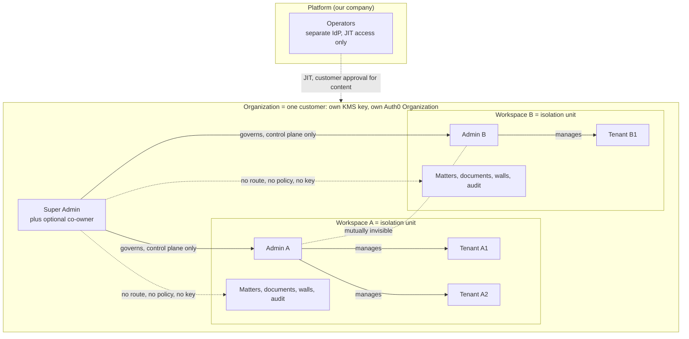

## 1. Executive summary

### 1.1 What the system is

The system answers natural-language questions over large legal and medical document sets (contracts, case files, clinical documents, regulatory filings) and returns answers whose every claim carries a machine-verified, page- and clause-level citation. It refuses to answer when the documents do not support an answer. It is multi-tenant for law firms, hospital systems and similar customers, audit-logged end to end, and designed so that an unsupported answer is never shown to a user.

The retrieval-augmented pipeline (hybrid search, re-ranking, a hard token budget, a deterministic citation validator) comes from the earlier documents and is kept. This version adds what they lacked: who a tenant is, how people join, who may see what, how identity reaches every internal service, how keys are protected from accidental or malicious deletion, how the system is built stage by stage, and how each stage is proven with `pytest` and `ruff` on real data.

### 1.2 The model in one picture

- **Organization (Super Admin).** The customer boundary: a law firm or hospital system. It has its own data partition, its own KMS key and its own Auth0 Organization. The Super Admin governs admins and never reads documents.
- **Workspace (Admin).** One per admin, many per organization, mutually invisible. An admin joins with the 64-character Organization Code and is activated after the Super Admin approves. Admins manage tenants and also do document work.
- **Tenant (member).** An end user inside exactly one workspace. A tenant joins with the admin's 32-character Admin Code and is activated after the admin approves.
- **Auth0 authenticates; our database authorizes.** Login, passkeys, MFA and organization membership live in Auth0. Role, workspace, status, grants, walls and approvals live in PostgreSQL, so suspension takes effect in seconds.
- **The database is the final authority; the vector store is not.** PostgreSQL row-level security decides what any caller may read. The vector store narrows search for recall and speed but is never trusted as a boundary (section 10.5).
- **No unverified text reaches a user.** Answers are released sentence by sentence only after the deterministic validator passes them, and no release happens before its audit record commits (section 11.6).

### 1.3 What changed in v3.0

| Change | Why | Where |
| --- | --- | --- |
| Key-deletion guardrails: two-person approval, long waiting windows, deletion protection, escrow and multi-Region backup, asymmetric powers (hard to destroy, easy to restore) | A per-organization KMS key makes one accidental or malicious deletion permanent | §12.5 to §12.8 |
| API table completed: first Admin Code, successor transfer, governance requests, break-glass, workspace state changes, walls, emergency access, operator plane | v2.1 flows had no endpoints | §15 |
| Platform operator access fully specified: identities, roles, JIT approval, expiry, recording | Mentioned in three places, never defined | §14 |
| State machines for organizations, workspaces, documents, access sessions and governance requests, kept as data and tested from that data | Only membership states existed | §6 |
| PostgreSQL is the authority; outbox re-indexing, drift reconciler and orphan-vector cleanup | Vector payloads lag after visibility or matter changes | §10.6 |
| Passkeys (phishing-resistant authentication) mandatory for Super Admins and admins; two approvers to delete an organization | Highest-power accounts need the strongest sign-in | §8.4, §12.7 |
| Ethical walls (explicit deny that beats every grant) and clinical emergency access | Legal and medical domain gaps | §5.6, §5.7 |
| Diagrams: hierarchy, onboarding, architecture, query flow, state machines, key hierarchy, destruction ritual, stage gates | v2.1 was text only | throughout |
| Corrections to defects found in v2.1 and the earlier documents, for example a tenant policy that exposed other users' private documents, HKDF keys that cannot be shredded independently, and a vector store wrongly counted as an isolation boundary | Logical contradictions and bugs | Appendix A |
| Twelve gated stages, real data only, `pytest` and `ruff` as mechanical gates, latest verified technology | Delivery plan requested | §19, §20 |

### 1.4 Delivery in twelve gated stages

Each stage MUST fully pass its gate before the next begins. Gates are cumulative: every earlier gate re-runs on every change (section 19.6).

| Stage | Name | Gate headline |
| --- | --- | --- |
| 0 | Foundation and real dependencies | Toolchain reproducible, `ruff` and `pytest` green, real Auth0, KMS, object store and corpus verified |
| 1 | Data layer and key management | RLS equals a reference oracle on random inputs; keys, shredding and KeyGuard proven |
| 2 | Identity and onboarding on Auth0 | All three onboarding paths, approvals, passkeys, governance requests work against a real Auth0 tenant |
| 3 | Gateway and internal trust | Token abuse rejected, revocation within SLO, context tokens enforced |
| 4 | Ingestion | Real documents ingested with provable chunk fidelity; index consistency proven |
| 5 | Retrieval | Scoped hybrid search with zero cross-scope leakage on provenance tests |
| 6 | Generation | Token budget invariants, scoped cache, injection resistance on live model |
| 7 | Citation validation and gated delivery | Zero unverified sentences released in live end-to-end runs |
| 8 | Frontend | Role routing, strict CSP, streaming torture tests, accessibility pass |
| 9 | Governance, audit, operators, lifecycle | Audit chain, alerts, JIT operator access, deletion ritual and restore drills pass |
| 10 | System verification | Isolation suite, load, chaos and evaluation floors met |
| 11 | Production readiness | External penetration test, counsel sign-off, vendor agreements, DR drill |

### 1.5 What this document proves and what it does not

It is a design. Every guarantee is a design claim until the gate that proves it passes (section 20). Three kinds of work cannot be closed by editing a document: performance under load, building and testing the code, and external review (penetration test, security architect review, counsel on HIPAA, privilege and retention, vendor agreements). Section 22 turns the performance risks into measurable budgets and section 25 lists the external items with owners and the stage that depends on each.