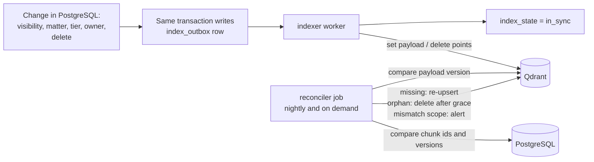

## 10. Layered isolation enforcement

### 10.1 The five layers

| Layer | Where | What it does | Boundary? |
| --- | --- | --- | --- |
| L1 | Browser and BFF | Route guards, hidden menus | No, user experience only |
| L2 | Gateway | Token validation, principal resolution, role route allow-list, rate limits and quotas | Yes |
| L3 | Services | Context-token verification; scoped repository objects that cannot run a query without context; no raw queries | Yes |
| L4 | **PostgreSQL** | RLS, composite foreign keys, FORCE policies | **Final authority** |
| L4b | Vector store, object store, Valkey | Mandatory vector filters and scoped keys, object prefixes and encryption, ACLs | Narrowing and defense in depth. **Not** a self-enforcing boundary for the shared vector collection (section 10.5) |
| L5 | Detection | Audit hash chain, anomaly alerts, canary and provenance tests in CI | Detects failures of L2 to L4b |

v2.1 listed the vector database among the layers that are "final authority". Qdrant's own security documentation scopes JWT access by collection and access level, not by payload, so in a shared collection a missing filter is not rejected by Qdrant (DEF-01). Postgres is therefore the single final authority, and retrieval always resolves chunk text from Postgres under RLS (section 10.5).

### 10.2 Partition key per store

| Store | Partition key | Mechanism | Optional silo tier |
| --- | --- | --- | --- |
| PostgreSQL | `org_id`, `workspace_id`, plus owner and matter | FORCE RLS, composite foreign keys | Dedicated database or cluster per organization |
| Qdrant | `workspace_id` as a tenant-indexed payload field (`is_tenant`) | One collection per embedding version; filter built only by `lmqa_vectorstore` from a principal; read-only key for retrieval | **Collection per workspace with a collection-scoped JWT**, which Qdrant itself enforces; or cluster per organization |
| Object storage | `org_{id}/ws_{id}/doc_{id}/v{n}` | Object keys built server-side from database rows, never from client input (a prefix is naming, not a control); presigned URLs of 60 seconds or less; application-level envelope encryption (section 12.3), plus SSE-KMS with the organization key in production | Bucket per organization |
| Valkey | `o:{org}:w:{ws}:…` | ACL user per service, scope-hashed cache keys, TTLs | Separate instance per organization |
| Audit | `org_id` control chain, `workspace_id` chains | `audit_append` function only; public-key sealed payloads | Per-organization WORM bucket |
| LLM provider | Per request | No-retention contract; per-organization provider setting | Self-hosted or VPC model |

### 10.3 PostgreSQL specifics

- **Roles.** Service roles are non-owners with `NOBYPASSRLS`. Every table uses `FORCE ROW LEVEL SECURITY` so even the owner is bound. Migrations run under a separate owner role that no service holds. Dedicated roles exist for `identity`, `gateway` (the `principal_v` view only), `retrieval`, `generation`, `validator`, `ingestion`, `audit_reader`, `reconciler` (column-level SELECT on IDs and index metadata, no text columns), `ops_metadata_ro` and `audit_writer` (EXECUTE on `audit_append` only).
- **Context** is set per transaction with `set_config('app.org_id', …, true)` and the same for workspace, user and role. Transaction-local settings are safe under PgBouncer transaction pooling; session-level settings would leak between requests. The scoped session helper in `lmqa_db` refuses to execute without a context (G1.7 tests this with interleaved sessions on the real pooler).
- **Fail closed.** Policies read the settings as `NULLIF(current_setting('app.org_id', true), '')::uuid` and likewise for the others. A plain `current_setting(..., true)` returns NULL only if the setting was never set on that connection; after any earlier transaction-local `set_config` on a pooled connection it returns an empty string, and casting that to a UUID raises an error instead of matching nothing (DEF-52). With `NULLIF`, an unset context is NULL and no row matches. Every service runs a **boot self-test**: a query with no context must return zero rows, and a query with a context for a different workspace must return zero rows; otherwise the service refuses to start.
- **Policies implement section 5.4 exactly.** Grant, wall, exception and break-glass lookups go through `STABLE` helper functions owned by a non-login `policy_helper` role. Because FORCE binds even owners, each lookup table has an explicit policy `TO policy_helper` limited to read access for the context user; no service role can call the helpers with another user's ID because the helpers take identity only from the transaction context.
- **Connection routing.** Request-path services connect through PgBouncer in transaction mode; the session-state features they must not use (session `SET`, session advisory locks, `LISTEN`/`NOTIFY`, long-lived cursors) are banned by a CI scan of every SQL string in the repository and a boot check. `psycopg` prepared statements are used only with PgBouncer's prepared-statement support (1.21 or later) or disabled. `audit_append` uses transaction-level advisory locks, which pooling allows. Procrastinate workers, the indexer's listener and Alembic migrations connect directly to PostgreSQL and still set the transaction-local context from the job envelope for every transaction (DEF-53).
- **Principal view.** `principal_v` exposes only what the Gateway needs: user ID, organization, workspace, role, states, `principal_version`, `scope_version` and `scope_hash`. It exposes no grants, walls or content.
- **Index plan.** Composite indexes `(workspace_id, user_id, matter_id)` on grants and walls, `(workspace_id, matter_id, visibility, owner_user_id)` on documents and chunks, partial indexes on active exceptions and sessions. Stage 10 measures policy overhead at 10,000 grants per user (section 22).
- **Super Admin policy** is control-plane only (section 5.3). Tenant counts for Manage Admins come from `workspace_usage`, a rollup of numbers maintained by a job.
- **Identity role** covers only control-plane tables. It has no BYPASSRLS and no access to documents, chunks or audit payloads, so compromising it does not expose content.
- **Audit writes** go through a `SECURITY DEFINER` function `audit_append` that computes the hash chain. No service role holds INSERT, UPDATE or DELETE on audit tables.
- **State machines** are enforced by transition tables and triggers (section 6.1).
- **Differential testing.** A pure-Python oracle implements section 5.4. A property-based test generates random organizations, memberships, grants, walls, exceptions and documents, then asserts that every `SELECT` through RLS returns exactly the oracle's answer, and that the vector filter builder produces a filter whose result set is a superset-or-equal of RLS's (G1.4, G5.4).

### 10.4 Behavior when a dependency fails

| Dependency down | Behavior |
| --- | --- |
| Auth0 | Existing sessions continue until their limits; new logins fail; the system fails closed (no anonymous access) |
| Valkey | Gateway reads PostgreSQL directly (no cache); rate limits degrade to a local conservative limit; answer cache bypassed |
| Qdrant | Retrieval returns 503; no fallback to a keyword scan of Postgres |
| KMS | Cached workspace keys keep working for their TTL (at most 15 minutes), then requests fail closed; certificates already issued keep working until they expire |
| PostgreSQL | Everything stops; no read replica serves writes |
| Audit write fails | The stream stops; no unaudited release |
| LLM provider | Query fails with a clear error; no silent switch to another provider unless the organization configured a fallback |
| Validator | No sentence is released; the query fails |

### 10.5 Vector search isolation

What Qdrant provides (verified against Qdrant's security documentation and release notes): granular JWT RBAC that limits tokens by collection and read or write access (and a `value_exists` claim that ties a token's validity to a record), payload indexes including `is_tenant` for co-locating a tenant's vectors, point retrieval by ID that does not accept a payload filter, audit logging from 1.17 and tiered multi-tenancy from 1.16. What it does not provide: row-level enforcement of a payload filter inside a shared collection. The JWT signing secret is also the shared API key, so any holder of that key can mint any token.

Design consequences:

- **Pooled default.** One shared collection per embedding version. `lmqa_vectorstore` is the only code that can reach Qdrant; its query functions require a principal, build the filter themselves and have no unfiltered variant. Delete-by-filter and payload-update calls also require the workspace filter, and point lookups by ID are never used with user-supplied IDs.
- **Postgres cross-check.** Qdrant returns chunk IDs only. Retrieval fetches chunk text from PostgreSQL by ID under RLS. An ID that Postgres refuses to return means either a stale index or a filter bug; it is dropped, counted in a mismatch metric and, if the reconciler's integrity job finds the ID belongs to a different scope, raised as a high-severity alert.
- **High-assurance tier.** Organizations that require the vector store itself to enforce isolation get one collection per workspace with a collection-scoped JWT minted by a small vector-access broker. The cost is operational (many collections) and it is offered as the silo option (D16).
- **Alternative evaluated.** `pgvector` would put vectors under the same RLS as everything else and remove this whole class of problem. It is rejected as the default because filtered approximate search at tens of millions of vectors per workspace is the Stage 10 risk, but it remains the fallback if load tests show the filtering wrapper and over-fetch path cannot meet the budgets (ADR 0004, DEF-47).
- **Vectors and sparse terms leak.** Embeddings can leak source content through inversion research, and the sparse index exposes terms. The vector database is a sensitive store: private network, encrypted disk, scoped keys, explicit deletion of vectors on document, workspace or organization removal. Keyword search cannot run over ciphertext, so protection is access control. The embedding provider is a data boundary too: sending PHI or privileged text to a third-party embedding API needs the same no-retention contract as the LLM, and sensitive organizations use a self-hosted embedding model.
- **Filter construction.** `org_id` and `workspace_id` always. Tenants: `(owner = me) OR (visibility = matter AND matter_id IN allowed AND tier ≤ max)` with `must_not` on walled matters. Admins: `(owner = me) OR visibility = matter`, plus private documents only when the flag and an active break-glass session allow it. Emergency exceptions add the exception's matter. If no filter can be built the answer is a 403, never an unfiltered search.
- **Very large grant sets.** A tenant with more than 256 granted matters would produce a large filter. Admins never need a matter list. For such tenants retrieval switches to **over-fetch and cross-check**: filter by workspace and visibility only, fetch up to 500 candidates, let PostgreSQL RLS discard disallowed ones, and widen up to a cap if fewer than needed survive. Because Postgres is the authority this is safe, and Stage 10 measures its latency (section 22).

### 10.6 Index consistency: PostgreSQL is the authority

When a document's visibility, matter, tier or owner changes, the vector payload lags. The rule: **PostgreSQL decides; the vector index follows.**

- The change and the `index_outbox` row are written in one transaction. The `indexer` applies payload updates or deletions and marks `index_state = in_sync`; failures retry with backoff and alert when the oldest pending item exceeds 60 seconds.
- **While `stale`, nothing leaks.** If access was narrowed, the vector payload still says "visible" but PostgreSQL RLS refuses the chunk, so it is dropped and counted. If access was widened, the document is simply not retrievable yet; this is the safe direction.
- **Reconciler.** Nightly and on demand, per workspace: compare every chunk's `payload_version` and ID in Qdrant with PostgreSQL's chunk list and index versions. Missing vectors are re-upserted (re-embedding if needed), orphan vectors (no Postgres chunk) are deleted after a 24-hour grace period, and any vector whose scope fields disagree with PostgreSQL is corrected and raised as an alert, since it could mean a filter or ingestion bug.
- **Chunks are immutable per document version.** A re-ingest creates a new version; searchable payloads carry `is_current`. Old chunk versions remain readable by audit under legal hold so a past citation can always be resolved.
- Document deletion destroys the document key (section 12.9), then the outbox deletes vectors and objects. The reconciler verifies that no vector remains for a deleted document.

### 10.7 Semantic cache

The earlier design matched near-duplicate queries "against the same document set" and let a hit skip retrieval, which also skips the access filter (DEF-06). v3.0 moves the cache **after** retrieval:

- The cache lives in `generation`. Retrieval always runs (it is cheap and always filtered); the cache saves the expensive LLM call.
- Key = hash of `org_id`, `workspace_id`, `scope_hash`, the hash of the retrieved chunk set (IDs and versions), `prompt_version`, model identifier, and the normalized query. Near-duplicate matching by query-embedding similarity is allowed only inside one such bucket.
- Because retrieval already produced only visible chunks, a hit cannot reveal anything the caller could not already retrieve. The validator still re-checks every cached answer against the current ledger, so permission or document changes cannot make a stale answer pass.
- Entries are encrypted with the workspace cache key (rotated daily so entries expire naturally) and live at most one hour. Cached answers contain PHI, which the original design says Redis should not hold, so caching is **off by default for medical organizations** and opt-in (D12). Entries are never shared across workspaces.

### 10.8 Async ingestion and fairness

Jobs carry the signed envelope (section 9.3). Queues are fair-share per workspace: each workspace has N job-lock slots (`ws:{id}:slot:{k}`, N = its concurrency cap), so a single lock never serializes a whole workspace and one admin's 5,000-page upload cannot starve others. Uploads use presigned PUT URLs constrained to the workspace prefix, size, content type and required SHA-256 checksum. Files are scanned and type-verified before OCR or parsing. Identical files, chunks and embeddings are never deduplicated or cached across workspaces, because deduplication would reveal that another workspace holds the same document (G4.9).

### 10.9 LLM and prompt layer

Only chunks that passed the filters reach the prompt, so the model cannot disclose what it never receives. The residual risk is a document shared to a matter that contains injected instructions. Controls: delimited chunk blocks with an explicit instruction hierarchy, request-local aliases instead of global IDs, no tools or network access for the generation model, the citation validator, and output sanitizing in the viewer. Prompts and completions are logged only into the organization-scoped, sealed audit payload.

### 10.10 Pooled by default, siloed when required

A small `OrgRouter` in `lmqa_db` maps `org_id` to its connection set (database DSN, vector collection or cluster, bucket, KMS key). Pooled infrastructure is the default mapping; a hospital system that requires physical separation gets a different mapping through the same interface. Database-per-organization is not the default because migrations and pools across hundreds of databases are costly; pooled storage with RLS and a key per organization delivers most of the isolation.