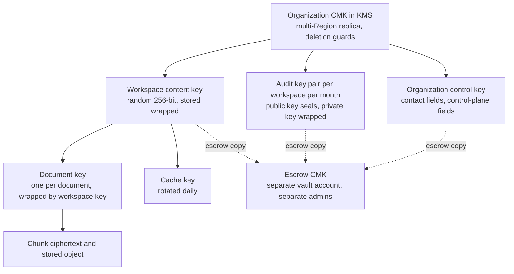
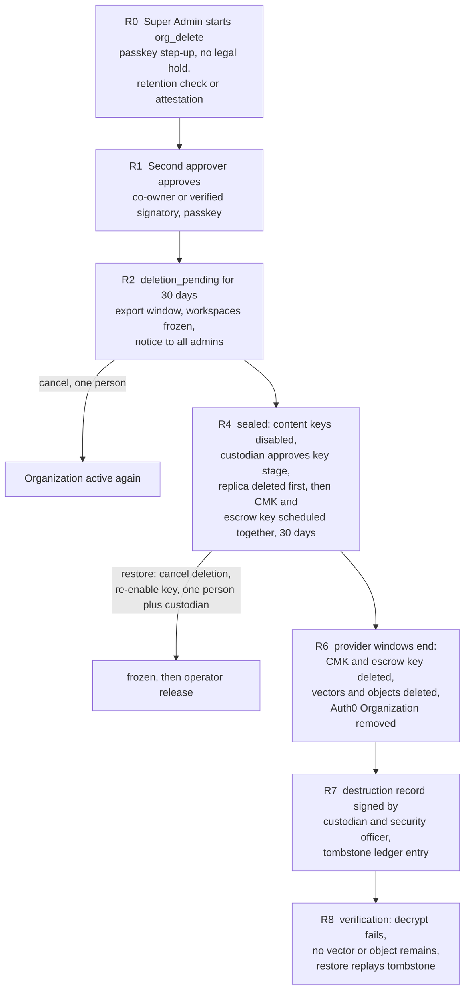

## 12. Encryption and key management

### 12.1 Key hierarchy

| Key | Type and scope | Wrapped by | Used by | Destroyed when |
| --- | --- | --- | --- | --- |
| Organization CMK | KMS symmetric key, one per organization, multi-Region primary plus replica | n/a (held in KMS) | Wrapping and unwrapping the keys below only | Organization destruction ritual (section 12.7) |
| Workspace content key | Random 256-bit key per workspace, versioned | Organization CMK | Wraps document keys and cache keys | Workspace destruction |
| Document key | Random 256-bit key per document | Workspace content key | Encrypts that document's chunk text and stored object | Document deletion (crypto-erase) |
| Audit key pair | X25519 key pair per workspace per calendar month | Private key wrapped by the CMK; public key stored in clear | Writers seal payloads with the public key; only the `audit` service unwraps the private key | End of that month's retention period |
| Organization control key | Random 256-bit key per organization | Organization CMK | Encrypts contact fields and sealed control-plane reasons | Organization destruction |
| Cache key | Random key per workspace, rotated daily | Workspace content key | Encrypts cached answers | Daily rotation (entries expire with it) |
| Blind-index key | Random key per organization | Organization control key | HMAC blind indexes for equality lookup (email) | Organization destruction |
| Code pepper | Secret in the secret manager, versioned | n/a | Keyed hashing of join codes | Rotation |
| Context-token trust root | KMS asymmetric key (ECC P-256), sign and verify only | n/a | Signs short-lived signer certificates (section 9.1) | Rotated every 90 days with overlap |

v2.1 derived workspace and audit sub-keys from one data key with HKDF. A derived key cannot be destroyed on its own (the parent can re-derive it), so "destroy content without touching audit retention" and per-workspace crypto-shredding were not achievable (DEF-03). Independent random keys, each wrapped, fix that.

### 12.2 What is encrypted

- **Column level:** document titles, chunk text, questions, answers, audit payloads, user contact fields, and reason text. AES-256-GCM with associated data binding `org_id`, `workspace_id`, object ID and version, so ciphertext copied into another row or workspace fails to decrypt.
- **Objects:** application-level envelope encryption (section 12.3), plus SSE-KMS with the organization CMK in production.
- **Disk and backups:** encrypted at rest beneath all of the above.
- **Equality lookups** (email, code lookup ID) use HMAC blind indexes.
- **Keyword and vector search cannot run over ciphertext**, so the vector database is protected by access control (section 10.5).

What this protects: storage, backup and snapshot breaches, and provable deletion. What it does not protect: an application bug that unwraps the wrong key, which is the job of RLS and scoped filters, and a compromise of a running service that legitimately holds keys in memory.

### 12.3 Object encryption

MinIO's server-side encryption hooks and the S3 SSE-KMS encryption context are not available identically in every S3-compatible local store, and the community edition of MinIO is in maintenance mode (section 4.5). Encryption is therefore done by the application, which gives identical behavior locally and in production and keeps plaintext out of the store:

1. Uploads land in the **quarantine prefix** (SSE-KMS in production, 24-hour lifecycle expiry; plaintext locally, acceptable because local data is public documents only, R4).
2. After scanning and parsing, the worker streams the file through chunked AES-GCM (1 MiB segments, per-segment nonces, a final-segment marker so truncation is detected) under the document key and writes it to the final prefix; then deletes the quarantine object.
3. Downloads are decrypted and streamed by `ingestion` through the Gateway. The browser never receives a URL to ciphertext; presigned URLs exist only for uploads to the quarantine prefix.

### 12.4 Rotation

- **CMK:** provider automatic rotation of key material (no data rewrite, no re-wrap).
- **Workspace content key:** a new version for new documents; old versions stay readable; documents are re-wrapped lazily. Document keys do not change.
- **Emergency rotation:** a runbook re-wraps a workspace's document keys under a fresh workspace key and, if the CMK is suspected compromised, creates a new CMK and re-wraps every key row for the organization.
- **Trust root:** every 90 days, with overlapping certificates; services trust both during the overlap.

### 12.5 Deletion guardrails

The per-organization key that makes shredding possible also makes one accidental or malicious deletion permanent. Four layers, plus an asymmetry rule, defend against it. Even *scheduling* deletion makes a key unusable while it is pending, so scheduling is an availability attack as well as a data-loss risk.

| Layer | Control |
| --- | --- |
| Preventive (cloud policy) | An organization-wide service control policy and the key policies explicitly deny `kms:ScheduleKeyDeletion`, `kms:DisableKey`, `kms:PutKeyPolicy` and `kms:DeleteImportedKeyMaterial` for every principal except two roles: `keyguard-destroyer` (may schedule deletion or disable) and `key-admin` (may change policy, with MFA and a change ticket). `keyguard-destroyer` can be assumed only by the KeyGuard workflow, which attaches session tags carrying two distinct approval IDs that the key policy checks. Service roles have only `Encrypt`, `Decrypt`, `GenerateDataKey` and `ReEncrypt` with encryption-context conditions; key administrators have no cryptographic use |
| Preventive (waiting window) | The provider's waiting period is always the maximum (30 days for AWS KMS) for every non-drill key. A policy lint in CI fails if any production key has a shorter window. Multi-Region primaries with replicas cannot complete deletion until the replicas are deleted, which adds a second hold (verify at pin) |
| Preventive (platform) | `org_keys.deletion_protection` stays true. KeyGuard refuses to call any destroy operation unless the organization is `sealed`, an `executable` governance request has the required distinct approvers, the waiting window has elapsed, retention has ended and no legal hold exists |
| Detective | Every `ScheduleKeyDeletion`, `DisableKey`, `CancelKeyDeletion`, `PutKeyPolicy` and key-material event raises a page to security on-call within 60 seconds. An automated responder compares the event with KeyGuard's approved records; if none matches it cancels the deletion and re-enables the key. The responder role can only cancel and enable |
| Asymmetry | Restoring is easy and fast: cancelling a scheduled deletion and re-enabling the key needs one person or the automated responder. Destroying is hard: two people, passkey step-up and a window |

### 12.6 Two-person approval, windows and sealing

| Operation | Approvers (distinct humans, passkey step-up within 5 minutes of each approval) | Wait |
| --- | --- | --- |
| Unseal a workspace | Super Admin (or co-owner) plus operator `key_custodian` | 72 h |
| Destroy a workspace's keys | Super Admin (or co-owner) plus operator `key_custodian`; retention ended; no legal hold | 30 days after approval |
| Delete an organization | Co-owner or a signatory verified out of band by an operator, plus `key_custodian` at the key stage | 30-day grace plus the provider window (at least 60 days in total) |
| Platform-initiated destruction (for example contract termination) | Authorized customer signatory verified by `security_officer`, plus two `key_custodian` operators | 30-day grace plus the provider window |

Approvals expire after 72 hours if not completed. Approvers cannot be the initiator, and a human who holds two identities is flagged by the owner-linked rules (section 5.9).

**Sealing.** Every workspace content key already has an escrow copy wrapped under the organization's **escrow CMK** in the vault account (section 12.8), whose key policy requires two custodian principals to use it. When a workspace becomes `sealed`, the CMK-wrapped copy in the database is removed, so services can no longer unwrap the key; unsealing means two custodians release the escrow copy and it is re-wrapped under the organization CMK. There is no separate "seal key" (DEF-56). "Unreadable by anyone" is therefore a property of the key setup, not only of a status flag.

### 12.7 The organization destruction ritual

The minimum elapsed time from request to irreversible destruction is 60 days. The drill version runs in a throwaway organization whose keys carry a `drill` tag that the policy lint allows to use the provider's 7-day minimum window, so the full path including the real KMS deletion is exercised annually (G9.6).

### 12.8 Backup, disaster recovery and escrow

- **Replica:** each organization CMK is a multi-Region primary with a replica in the DR Region, so a regional failure does not strand data.
- **Escrow:** wrapped copies of workspace, control and audit keys are also written under an **escrow CMK** in a separate vault account with separate administrators and no day-to-day access. If the primary account, the CMK and the replica were all lost or maliciously deleted, escrow still allows recovery. Escrow keys are per organization so organization destruction can destroy them too.
- **Data backups:** PostgreSQL point-in-time recovery, Qdrant snapshots, object versioning, and hourly Merkle anchors in an Object Lock bucket, all copied cross-Region. Backups contain only ciphertext and wrapped keys, so they are unreadable without the CMK.
- **Customer-held keys:** if an organization brings its own key, loss of that key by the customer is loss of data by design; the contract says so.
- **Drills:** quarterly restore from escrow into an isolated account; annual full destroy drill; annual restore-and-shred drill that proves a shredded organization stays unreadable in a restored backup.

### 12.9 Shredding semantics and backups

| Deletion scope | What is destroyed | Effect in live systems | Effect on backups |
| --- | --- | --- | --- |
| One document | Its document key | Chunk text and object unrecoverable at once; vectors and objects deleted by the outbox | The wrapped key still exists in older backups until they expire (maximum 35 days) |
| One workspace | Workspace content key, all document keys, audit keys at the end of their retention | Same | Same, plus the **tombstone ledger** |
| One organization | The CMK and escrow keys | Everything unreadable immediately after the provider window | Unreadable forever, because every wrapped key in every backup depends on the destroyed CMK |

v2.1 claimed that per-organization keys make restored backups unreadable for any deletion. That is true only at organization level: a backup of the wrapped-key table taken while the organization's CMK still exists can unwrap a deleted document's key (DEF-04). The fix is a **tombstone ledger** kept outside the backup set (an Object Lock bucket in the vault account) that records every document, workspace and tenant deletion. Any restore replays the ledger before the restored system accepts traffic, and restores are per organization. Backups expire within 35 days, which bounds the window.

### 12.10 Local mode and repository hygiene

- Key provider interface with two real adapters: AWS KMS (dev account) and OpenBao Transit. OpenBao allows immediate deletion for the tests that must prove shredding; AWS KMS is used for everything that depends on its real behavior (policies, windows, signing). A file-backed fake is **not** used (DEF-10).
- `.gitignore` in the first commit ignores `.env`, `.env.*`, `.secrets/`, `*.pem`, `*.key` with an explicit `!.env.example` (a bare `.env*` pattern also hides the template). gitleaks runs as a pre-commit hook and a CI check; peppers and signing keys never appear in `compose.yaml`.