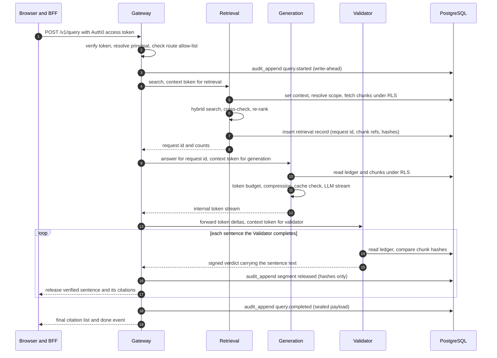

## 4. System architecture

### 4.1 Three planes

| Plane | Contains | Who uses it | Key property |
| --- | --- | --- | --- |
| Data plane | Gateway data routes, Ingestion, Retrieval, Generation, Citation Validator, Audit reader | Admins and tenants | Handles document content; every access is scoped by workspace, matter, grants, walls |
| Control plane | Identity service, Gateway control routes, governance requests | Super Admins, admins | Manages accounts, codes, policies, states; physically cannot read content (no database policy covers content tables for control-plane roles) |
| Operations plane | Ops API, operator console, KeyGuard workflow | Platform operators | Separate ingress, separate identity provider, JIT access only, no content reach without customer approval (section 14) |

### 4.2 Service catalog

Every service is its own deployable, Docker image and database role. Ports are local-host defaults.

| Service | Port | Responsibility | Credentials it holds | Must never |
| --- | --- | --- | --- | --- |
| `frontend` (Next.js 16) | 3000 | UI and BFF route handlers; the only thing the browser talks to; owns the Auth0 session in a server-side session store | Auth0 client secret, session secret, Valkey ACL user for the session store only | Hold database, KMS, vector or object-store credentials |
| `gateway` | 8000 | Token verification, principal resolution, route allow-list, rate limits, idempotency, context-token minting, forwarding of the generation stream to the Validator, release of verified sentences | DB role limited to the `principal_v` view (which also exposes `scope_hash` and `scope_version`, section 16.2) and `audit_append`; Valkey ACL user; KMS permission to sign signer certificates only | Decrypt anything, read documents, call the Auth0 Management API, touch object storage |
| `identity` | 8005 | Onboarding, organizations, workspaces, memberships, join codes, governance requests, Auth0 sync, provisioning saga, revocation fan-out | DB role on control-plane tables only; Auth0 Management M2M; KMS for org key provisioning and control-field encryption; SMTP | Read documents, chunks, or audit payloads |
| `ingestion` (+ worker, indexer, reconciler) | 8001 | Upload intake, document lifecycle API, scan, parse, OCR, chunk, embed, write vectors, outbox re-indexing, drift repair | Object store read/write, Qdrant read/write key, DB role, KMS via keys library, embedding model | Serve queries |
| `retrieval` | 8002 | Scope resolution, hybrid search, Postgres cross-check, re-rank, retrieval ledger write | Qdrant **read-only** key, DB role, KMS decrypt for workspace keys, Valkey (scope cache) | Write vectors, call an LLM, read the object store |
| `generation` | 8003 | Token budget, compression, prompt assembly, LLM call, scoped answer cache | DB role (ledger and chunks under RLS), per-organization LLM provider key, Valkey (cache), KMS for cache key | Read vectors, bypass the ledger |
| `citation_validator` | 8004 | Sentence segmentation, deterministic validation of every sentence and tag, signed verdicts | DB role (read-only ledger and chunks), KMS decrypt for chunks, verdict-signing key | Call a generative LLM, write chunks |
| `audit` | 8007 | Audit read, search, export, hash-chain verification, hourly anchoring | DB audit-reader role, KMS decrypt for audit private keys, write access to the anchor bucket | Write ordinary audit events (writers use the database function) |
| `ops` | 8006 | Operator plane: JIT access requests, KeyGuard approvals, organization recovery, security holds | DB role on ops and governance tables; call to identity internal API | Read content; use customer Auth0 tenants |

Workers and scheduled jobs: `ingestion-worker` (parse, OCR, embed), `indexer` (applies the re-index outbox), `reconciler` (vector drift repair), `identity-worker` (saga steps, Auth0 sync, revocation fan-out), `audit-anchor` (hourly Merkle anchor), `retention` (retention and legal-hold enforcement).

All services write audit events through the `audit_append` database function using a payload sealed to a public key (section 13.2); none of them holds a key that can read audit payloads except the `audit` service.

### 4.3 Master system design

One diagram of the whole system: people, identity providers, tiers, services, stores, keys and external services. Solid arrows are runtime calls; dotted arrows are key or data-lifecycle relationships. An arrow into a store shows which service holds access to it and with what privilege.

```mermaid
flowchart TB
  subgraph PEOPLE["People"]
    SA["Super Admin and co-owner"]
    AD["Admin"]
    TE["Tenant"]
    OPR["Platform operators<br/>sre, support, security officer, key custodian"]
  end
  subgraph IDP["Identity providers"]
    A0["Auth0 customer tenant<br/>Universal Login, passkeys, MFA, Organizations"]
    A0P["Operator IdP<br/>separate tenant, passkeys, device certificate"]
  end
  subgraph PRES["Presentation tier"]
    FE["Next.js 16 BFF :3000<br/>proxy.ts, CSP nonces, generated client"]
    SS[("Valkey session store<br/>opaque session ID in the browser")]
  end
  subgraph CTRL["Control plane"]
    GW["Gateway :8000<br/>token check, principal, allow-list,<br/>context tokens, stream release"]
    ID["Identity :8005<br/>onboarding, codes, governance,<br/>provisioning saga, Auth0 sync"]
  end
  subgraph DATA["Data plane"]
    IN["Ingestion :8001<br/>upload, scan, OCR, chunk,<br/>worker, indexer, reconciler"]
    RT["Retrieval :8002<br/>scope, hybrid search, cross-check,<br/>re-rank, retrieval ledger"]
    GN["Generation :8003<br/>token budget, compression,<br/>prompt, LLM, scoped cache"]
    VL["Citation Validator :8004<br/>segmenter, checks V1 to V8,<br/>signed verdicts"]
    AU["Audit :8007<br/>read, verify, anchor"]
  end
  subgraph OPSP["Operations plane, separate ingress"]
    OC["Operator console"]
    OP["Ops API :8006<br/>JIT access, KeyGuard, recovery"]
  end
  subgraph STORES["Stores"]
    PG[("PostgreSQL 18 via PgBouncer<br/>RLS is the final authority")]
    QD[("Qdrant<br/>read-only key: retrieval<br/>read-write key: ingestion")]
    OS[("Object store<br/>encrypted objects")]
    VK[("Valkey<br/>principal cache, limits,<br/>pub/sub, answer cache")]
    WORM[("Object Lock bucket<br/>hourly audit anchors")]
    TS[("Tombstone ledger<br/>outside backups")]
  end
  subgraph KEYS["Keys and trust"]
    KMS["KMS<br/>organization CMK and replica,<br/>trust root"]
    ESC["Escrow CMK<br/>vault account, two custodians"]
  end
  subgraph EXT["Models and external services"]
    MOD["Embedding, re-rank, entailment<br/>models, self-hosted"]
    LLM["LLM provider<br/>per-organization boundary"]
    AV["ClamAV"]
    MAIL["SMTP"]
  end

  SA --> FE
  AD --> FE
  TE --> FE
  FE -- "login, PKCE" --> A0
  FE --> SS
  FE -- "Auth0 access token" --> GW
  OPR --> OC
  OC --> A0P
  OC --> OP

  GW -- "context tokens" --> ID
  GW -- "context tokens" --> RT
  GW -- "context tokens" --> GN
  GW -- "context tokens, token stream" --> VL
  GW -- "context tokens" --> IN
  GW -- "context tokens" --> AU
  GW --> VK
  GW -- "principal_v, audit_append" --> PG
  GW -. "signer certificate" .-> KMS

  ID -- "Management API" --> A0
  ID --> PG
  ID --> KMS
  ID --> MAIL
  ID -- "revocation publish" --> VK

  IN --> OS
  IN -- "read-write" --> QD
  IN --> PG
  IN --> AV
  IN --> MOD
  IN --> KMS

  RT -- "read-only" --> QD
  RT --> PG
  RT --> MOD
  RT --> KMS

  GN --> PG
  GN --> LLM
  GN --> VK
  GN --> KMS

  VL --> PG
  VL --> MOD
  VL --> KMS

  AU --> PG
  AU --> WORM
  AU --> KMS

  OP --> ID
  OP --> PG
  OP -- "KeyGuard approvals" --> KMS

  KMS -. "escrow copies" .-> ESC
  PG -. "deletion records" .-> TS
```

| Boundary | What crosses it | Enforced by |
| --- | --- | --- |
| Browser to presentation tier | An opaque session ID only | Server-side session store, strict CSP (section 17.3) |
| Presentation tier to Gateway | The Auth0 access token, which is never forwarded further | Token verification (section 8.5) |
| Gateway to services | A one-audience, 60-second context token plus the caller's own service credential | Section 9 |
| Services to stores | Scoped database roles, read-only versus read-write vector keys, per-service ACLs and KMS grants | Sections 9.2 and 10 |
| Everything to keys | Encryption-context-bound KMS calls; destruction needs two people and a window | Section 12 |
| Operators to customer data | Just-in-time, customer-approved, time-boxed, audited access only | Section 14 |

### 4.4 Query flow with gated release

Rules that follow from the diagram:

1. The Gateway orchestrates the fan-out; services never call each other and never forward user context. Retrieval hands off through the **retrieval ledger** in PostgreSQL, so chunk text never travels through the Gateway.
2. Generation and the Validator read chunks themselves, under RLS, by reference (chunk ID, version, content hash). A chunk that changed between retrieval and validation fails the hash comparison and the sentence is not released.
3. The Validator, not the Gateway, owns sentence segmentation, so the unit that is validated is exactly the unit that is released. The Gateway releases a sentence only when it holds a verdict signed by the Validator for that sentence (the verdict carries the sentence text and its hash) and this request. The final audit record stores the hash of everything released and the verdict signatures, so "what was released equals what was validated" is checkable later.
4. If an audit write fails at any point, the stream stops with an error. Nothing is released unaudited (principle 10).

### 4.5 Technology stack and version ledger

Versions below were checked on October 23, 2026. The lockfile (`uv.lock`, `pnpm-lock.yaml`) and the container image digests are the authority; Stage 0 records the exact resolved versions in `docs/versions.md` and gate G0.1 fails if they drift.

| Layer | Choice | Verified baseline | Why and notes |
| --- | --- | --- | --- |
| Python | 3.14 | 3.14 stable; 3.15 final was scheduled for October 1, 2026 | Newest interpreter with a full wheel ecosystem. Adopt 3.15 only after its first patch release and wheels for every dependency (policy below) |
| Package and project manager | `uv` workspace | 0.11.x (0.11.26 seen in June 2026) | One lockfile for all services and libs; `uv sync --frozen` in CI |
| Lint and format | `ruff` | 0.16.x (0.16.4 seen in August 2026) | 0.16 enables 413 rules by default and formats Python code blocks in Markdown; we select rules explicitly so upgrades never change the gate silently (section 19.3) |
| Test runner | `pytest` | 9.1.x (9.1.1 seen in June 2026) | With `pytest-asyncio`, `pytest-xdist`, `pytest-cov`, `pytest-randomly`, `pytest-timeout`, `hypothesis`, `schemathesis`, `pytest-playwright` |
| Type checking | `pyright` (blocking); `ty` informational | `ty` is still 0.0.x | Strict on `libs/` and security-critical services |
| Web framework and models | FastAPI latest 0.1xx, Pydantic 2.13+ | Pydantic 2.13.x (2.13.3 seen in April 2026); FastAPI supports Python 3.14 and has deprecated Pydantic v1 | Pydantic v2 only. Async end to end |
| Database access | SQLAlchemy 2 (async), `psycopg` 3, Alembic | latest at pin | Only through `lmqa_db`'s scoped session |
| Relational database | PostgreSQL 18 | 18.6 (August 2026); 18.5 was skipped for a regression; PostgreSQL 19 general availability was expected around October 2026 | Adopt 19 after GA plus its first minor release |
| Connection pooler | PgBouncer (transaction pooling) for the request path | latest (prepared-statement support needs 1.21 or later) | Request-path services connect through it with prepared statements configured for pooling. Workers that use `LISTEN`/`NOTIFY` or session advisory locks, and migrations, connect to PostgreSQL directly. The leak test for transaction-local context runs against the real pooler (G1.7) |
| Vector database | Qdrant | server 1.19.x (client 1.19.0 exists; 1.18.2 appears in Qdrant's own release table) | Upgrade one minor at a time as Qdrant requires. 1.16 added tiered multi-tenancy; 1.17 added audit logging |
| Cache, rate limits, pub/sub | Valkey | 9.1.x (May 2026) | BSD-licensed, RESP-compatible with Redis clients. Redis 8 is AGPL; Valkey avoids the licence review (D20) |
| Background jobs | Procrastinate (PostgreSQL-backed) | latest major at pin | Jobs are plain tables and SQL functions, so the application enqueues by calling the SQL defer function inside its own transaction, which removes "job ran before commit" races and fits the outbox pattern. Workers connect directly to PostgreSQL (not through the transaction pooler). Acceptance is proven by the Stage 0 spike (G0.13, D18). Fallback: Celery 5.6. Arq is excluded: the Taskiq project lists it as no longer actively maintained |
| Object storage | S3 in production; SeaweedFS locally | MinIO community edition entered maintenance mode in December 2025 | Local store chosen by a capability probe (versioning, presigned URLs, multipart, checksums). Application-level encryption makes SSE-KMS optional (section 12.3) |
| Frontend | Next.js 16.3.x, React 19.2, Node.js 24 LTS | Next.js 16 is the current major; security releases follow a published monthly schedule (16.3.7 was the September 30, 2026 entry on that schedule), so confirm the latest patch at pin | `proxy.ts` replaces `middleware.ts`; patch within each scheduled security-release window |
| Frontend auth | `@auth0/nextjs-auth0` v4 | 4.13 or later | `Auth0Client` in `lib/auth0.ts`; routes mounted at `/auth/*` by `proxy.ts`; app type "Regular Web Application" |
| Styling and UI | Tailwind CSS 4, shadcn/ui primitives | latest | Server components by default |
| Identity | Auth0 (Universal Login, Organizations, Actions, passkeys, M2M) | Plan check required (section 8.1) | HIPAA BAA is an Enterprise add-on; some attack protection is an add-on |
| Infrastructure as code | OpenTofu (Terraform-compatible) with the Auth0 and AWS providers | latest | Auth0 tenant configuration is code and drift-tested |
| Key management | AWS KMS (reference); OpenBao Transit locally for fast shredding tests | n/a | Both are real systems. Real KMS from Stage 0; OpenBao for the tests that need immediate key destruction (KMS enforces a 7 to 30 day wait) |
| Embeddings (candidates) | `bge-m3` (dense plus sparse), Qwen3-Embedding | chosen by the Stage 4 and 5 bake-off | Self-hosted by default so no document text leaves the boundary |
| Re-ranker (candidates) | `bge-reranker-v2-m3`, Qwen3-Reranker | Stage 5 bake-off | CPU-friendly default locally, GPU optional |
| Entailment model (candidate) | DeBERTa-v3 NLI cross-encoder | Stage 7 calibration | Pinned weights hash, CPU inference, fixed thresholds |
| Parsing and OCR (candidates) | Docling (layout-aware), Tesseract 5, `pypdfium2` | Stage 4 bake-off against a plain `pdfplumber` plus Tesseract baseline | Avoid AGPL parsers in a commercial product (PyMuPDF is AGPL or paid) |
| Malware scan | ClamAV | latest | Runs before any parser |
| Observability | OpenTelemetry, Grafana (Loki, Tempo, Prometheus) | latest | `org_id` and `workspace_id` as span attributes; never content |
| Load and browser tests | k6, Playwright | latest | k6 for load; Playwright with a virtual WebAuthn authenticator for real Auth0 login |
| Supply chain | CycloneDX SBOM, cosign keyless signing, GitHub artifact attestations, Trivy, gitleaks, Semgrep | latest | Release attestations of `ruff` and `uv` are verified in CI |

**Adoption policy.**

- New major runtime or database versions are adopted only after general availability, their first patch release, driver and wheel availability, and a full cumulative gate run on a branch.
- Security fixes: critical within 72 hours, high within 7 days, even if the cooldown has not elapsed.
- Other dependency updates wait a 7 to 14 day cooldown before merge so a malicious release is likely caught first.
- Container images are pinned by digest; base images are non-root and minimal.

### 4.6 Environments and what is real in each

| Concern | Local dev | CI | Staging | Production |
| --- | --- | --- | --- | --- |
| Identity | Auth0 `dev` tenant, real sign-ups | Auth0 `ci` tenant, same Actions and policies as production, applied from code | Auth0 `staging` tenant | Auth0 `prod` tenant with BAA where PHI is processed |
| Operator identity | n/a | `platform-staging` tenant | `platform-staging` | `platform-prod` (separate company IdP or Auth0 tenant) |
| Key management | AWS dev account KMS; OpenBao for shred tests | AWS CI account via OIDC federation (no static keys) | AWS staging account | AWS production account plus vault account for escrow |
| Audit anchor | Real S3 bucket with Object Lock (dev) | Real, CI account | Real | Real, WORM compliance mode |
| Postgres, Valkey, Qdrant | Compose containers | Service containers | Managed or Helm-deployed | Managed or Helm-deployed, HA |
| Object store | SeaweedFS | SeaweedFS | S3 | S3 |
| LLM and embeddings | Real provider key with a spend cap, or self-hosted model | Same, nightly live lane | Real, no-retention terms | Real, BAA or VPC-isolated per organization |
| Data | Public real corpus only | Public real corpus only | Public real corpus only | Customer data |
| Email | Real mailbox on a project-owned domain, read over IMAP | Same | Real | Real transactional provider |

`make doctor` verifies every real dependency (credentials present, reachable, budgets set) before any test runs and prints what is missing.

### 4.7 Allowed calls and import boundaries

Network rules (Compose networks locally, network policies in Kubernetes): the browser reaches only the frontend; only the frontend reaches the Gateway (and, for sessions, its own Valkey ACL user); only the Gateway reaches internal services; only `retrieval` (read-only) and `ingestion` (read-write) reach Qdrant; only `ingestion` and its workers reach the object store; only `identity` reaches the Auth0 Management API; only `ops` is exposed on the operator ingress.

Code rules, enforced in CI by `import-linter` contracts and `ruff` banned-API rules (G0.5, G0.11):

| Rule | Enforced by |
| --- | --- |
| No service imports another service's package | import-linter "independence" contract |
| `gateway` cannot import `lmqa_vectorstore`, `lmqa_objectstore`, chunk models, or decrypt functions of `lmqa_keys` | import-linter "forbidden" contract |
| `retrieval` cannot import `lmqa_objectstore` or any LLM client | same |
| `citation_validator` cannot import any LLM client, `lmqa_vectorstore` or `lmqa_objectstore` | same |
| `identity` cannot import chunk, document-content or audit-payload models | same |
| Only `lmqa_db` may create engines or connections; services use its scoped session, which refuses to run without a context | `ruff` TID251 banned API (`sqlalchemy.create_engine`, `psycopg.connect`) outside `lmqa_db` |
| Only `lmqa_vectorstore` may hold a Qdrant client; its query methods build the filter from a principal and have no unfiltered variant | import-linter plus unit tests |
| The frontend calls the Gateway only through the generated API client | ESLint restricted-imports rule |

### 4.8 Compatibility constraints and how the design handles them

Components that work alone can fail together. These are the cross-component constraints found in the second review pass, each with the gate that proves the handling.

| Constraint | Components | Handling | Gate |
| --- | --- | --- | --- |
| Transaction pooling breaks session state: `LISTEN`/`NOTIFY`, session advisory locks, session `SET`, and prepared statements without pooler support | PgBouncer, Procrastinate, `psycopg`, Alembic | Request path through the pooler with prepared statements configured for it; workers and migrations on direct connections; `audit_append` uses transaction-level locks | G0.13, G1.7 |
| A transaction-local setting leaves an empty string, not NULL, on a reused connection | PostgreSQL, PgBouncer, RLS policies | `NULLIF(current_setting(...), '')` in every policy | G1.3 |
| Next.js 16 replaced `middleware.ts` with `proxy.ts`; the Auth0 SDK v4 mounts `/auth/*` routes from it and needs a "Regular Web Application" client | Next.js, `@auth0/nextjs-auth0`, Auth0 | `proxy.ts` only; client type fixed in OpenTofu | G0.7, G8.1 |
| The SDK's default stateless session puts encrypted tokens in the browser and cannot be revoked server-side | `@auth0/nextjs-auth0`, Valkey | Server-side session store keyed by an opaque ID | G8.5 |
| A per-request CSP nonce forces dynamic rendering | Next.js 16, CSP | Accepted; static assets remain cacheable | G8.6 |
| Qdrant JWT scopes are per collection and the signing secret is the API key | Qdrant, `lmqa_vectorstore` | Filtering wrapper, separate read-only and read-write keys, Postgres as final authority, collection-per-workspace tier | G5.1, G5.4 |
| Hybrid dense plus sparse search needs named vectors and the Query API, so client and server versions must match | Qdrant, `qdrant-client` | Client pinned to the server's minor version | G0.4 |
| S3-compatible local stores differ from S3 on Object Lock and SSE-KMS encryption context | SeaweedFS, S3, KMS | Application-level encryption; Object Lock exercised only on real S3 | G0.4, G0.9 |
| KMS enforces a 7 to 30 day deletion window, which CI cannot wait for | AWS KMS, tests | OpenBao Transit for immediate-shred tests; real KMS for schedule, cancel and policy tests; `drill` tag for the annual full drill | G1.11, G9.6 |
| KMS signing quotas versus one signature per request | AWS KMS, Gateway | KMS signs hour-long signer certificates; instances sign tokens locally | G3.5 |
| ML libraries may lack wheels for the newest Python | Python 3.14, PyTorch, transformers, ONNX Runtime, Docling | Wheel check at lock time; the model-serving images may pin Python 3.13, recorded in `docs/versions.md` | G0.1 |
| `ruff` 0.16 enables 413 rules and formats Python code blocks in Markdown | `ruff`, docs | Explicit rule list; `docs/` excluded from the format check | G0.2 |
| Pydantic v1 is deprecated in current FastAPI | FastAPI, Pydantic | Pydantic v2 only; `pydantic.v1` is a banned import | G0.2 |
| Passkey and WebAuthn automation exists only in Chromium (virtual authenticator) | Playwright, Auth0 | Authentication flows run on Chromium; other browsers run non-authenticated smoke tests | G8.1 |
| The names Auth0 Actions see for authentication methods may change | Auth0 Actions | Contract test pins them | G2.7 |
| Presigned PUT with a required checksum needs matching headers and CORS from the browser | Object store, browser | Upload helper sets headers; CORS configured as code | G4.1 |
| SSE is broken by proxy buffering or compression | Next.js route handlers, ingress | `text/event-stream` excluded from buffering and compression; byte-boundary torture test | G8.4 |
| HPKE sealing needs an interoperable, maintained implementation | `lmqa_security` (writers), `audit` (reader) | RFC 9180 library, cross-implementation test vectors | G9.2 |
| Valkey is RESP-compatible, but ACL and pub/sub behavior must match what the clients expect | Valkey, Redis clients | Smoke and revocation tests run against Valkey itself | G0.4, G3.4 |
| Mermaid diagrams must render in the viewers people use | Documentation | Parsed in CI | G0.12 |