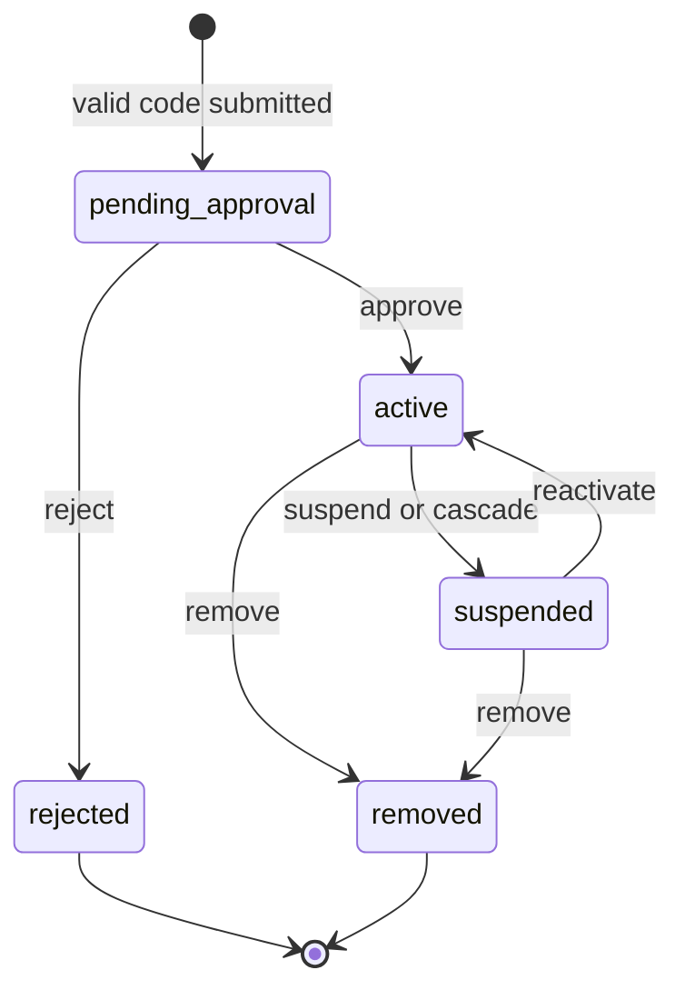
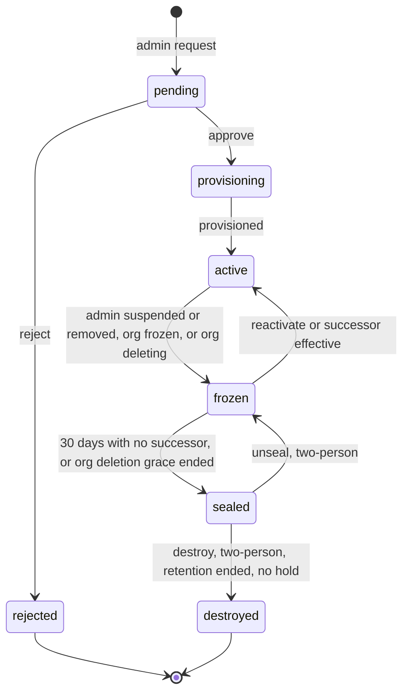
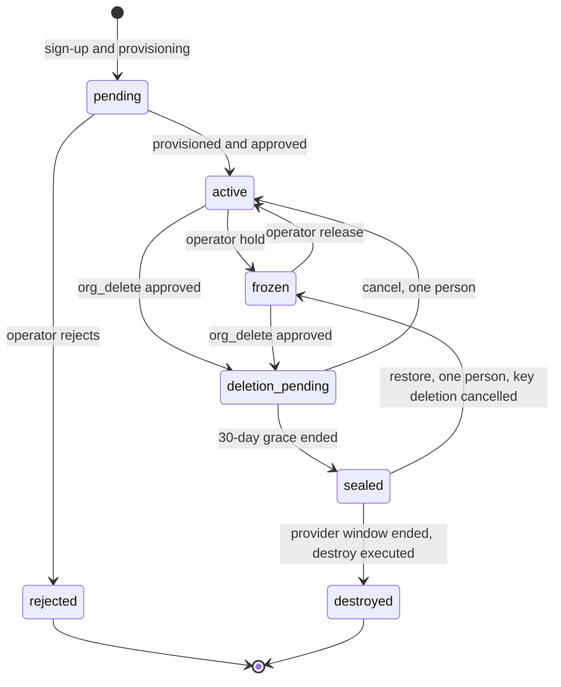

## 6. Lifecycle state machines

### 6.1 Principles

Every lifecycle in this section is declared in `contracts/state-machines.yaml`: states, allowed transitions, who may trigger each, guard conditions and side effects. The declaration is the single source for three things:

1. **Database enforcement.** Each stateful table has a transition table and a trigger that rejects any change not listed, so an application bug cannot skip a state.
2. **Service enforcement.** The `lmqa_models` package generates the transition guards from the YAML.
3. **Tests.** A generated test suite tries every legal transition as an authorized actor (must succeed), every legal transition as an unauthorized actor (must fail with 404 or 403) and every illegal pair (must fail), against the real database and API (G1.9, G2.9, G9.9).

### 6.2 Membership

| State | Meaning | Data access | Sessions |
| --- | --- | --- | --- |
| `onboarding` (not stored) | Authenticated, no membership yet | None | Onboarding scope only |
| `pending_approval` | Valid code submitted, waiting for the approver | None | Status page only |
| `active` | Approved | Per role, grants, walls | Normal |
| `suspended` | Paused by an approver or by cascade (reason code stored: `admin_action`, `workspace_frozen`, `org_frozen`, `security_hold`) | None; data retained | Revoked at once |
| `rejected` | Approver declined | None | Revoked |
| `removed` | Off-boarded | None; data handled per section 7.7 | Revoked |

The approver is the Super Admin for admins and the workspace admin for tenants. Nobody approves or changes their own membership. The Super Admin's first membership is created `active` by the provisioning saga, and the only way to add a Super Admin afterward is the co-owner flow.

### 6.3 Workspace

| State | Meaning | Who can read data | Notes |
| --- | --- | --- | --- |
| `pending` | Admin requested; awaiting Super Admin | Nobody; no partition yet | Pending workspace removed on reject |
| `provisioning` | Approved; partition, keys and quotas being created | Nobody | Idempotent saga; stays here and retries if a step fails |
| `active` | Normal operation | Per section 5.4 | |
| `frozen` | Admin suspended or removed, or organization frozen | Nobody; sessions revoked; data retained | Admin Code disabled; tenants carry `workspace_frozen` |
| `sealed` | Frozen with no decision after 30 days, or organization deletion grace ended | Nobody, including operators | Content keys are re-wrapped under an escrow key that needs two custodians to release (section 12.6). Reversible until destroyed |
| `destroyed` | Keys destroyed, vectors and objects deleted | Nobody | Destruction record kept in audit metadata |

### 6.4 Organization

| State | Meaning | Access |
| --- | --- | --- |
| `pending` | Saga running, and in production awaiting operator approval (D9) | None for everyone except the Super Admin, who may sign in to enroll authenticators and see the status page; no governance action and no code generation until `active` |
| `active` | Normal | Per roles |
| `frozen` | Operator hold: non-payment, security hold or legal order. Reason code stored | All sessions revoked; read-only export window for the Super Admin and admins; nothing deleted |
| `deletion_pending` | 30-day grace after an approved `org_delete` | Export allowed; everything else blocked; one person can cancel |
| `sealed` | Grace over; all content keys disabled; KMS deletion scheduled at the provider maximum (30 days) | Nobody. Restoring needs one person plus the key custodian's cancel action |
| `destroyed` | Keys, vectors, objects, and Auth0 Organization removed | None; destruction record remains |

### 6.5 Documents and index state

Document `status`: `uploading` → `scanning` → `parsing` → (`ocr_review` when any page is below the confidence threshold) → `indexing` → `indexed`; side exits `failed`, `held` (owner removed; section 7.7), `deleting` → `deleted` (tombstone kept). Each document version has `index_state`: `in_sync`, `stale` (Postgres changed, vector payload not yet updated), `reindexing`. Only `indexed` plus `in_sync` content is searchable; `stale` content is searchable only if Postgres still allows it (section 10.6).

### 6.6 Join codes

States: `active` → `rotated`, `expired`, `exhausted`, `disabled`, `revoked`. Rotation moves the old code to `rotated` instantly. `disabled` is set by cascade (workspace frozen). A use is counted only when a membership is created (idempotent).

### 6.7 Governance requests

A governance request is the single mechanism for control-plane actions that need two people and a waiting window. State: `requested` → `approved` → `waiting` → `executable` → `executed`; exits `rejected`, `cancelled`, `expired` (approvals expire after 72 hours), `failed`. The initiator can always cancel (restoring direction). Approvers must be distinct humans (distinct identities and distinct authenticators) from the initiator and each other, and each approval needs passkey step-up within 5 minutes.

| Kind | Initiator | Second approver | Wait | Effect |
| --- | --- | --- | --- | --- |
| `successor_transfer` | Super Admin | Co-owner, or an operator `security_officer` after out-of-band confirmation with the contract signatory | 72 h | Re-parents a frozen workspace to the pending successor membership (section 7.8); resets `admin_can_read_private`; notifies tenants and the outgoing admin |
| `private_read_enable` | Admin | Super Admin (control-plane approval) | 24 h | Enables break-glass capability; notifies all tenants |
| `wall_lift` | Admin (wall on a tenant) or Super Admin (wall on an admin) | Super Admin (wall on a tenant) or operator `security_officer` after out-of-band confirmation (wall on an admin) | 24 h | Removes the wall; notifies the affected user |
| `workspace_unseal` | Super Admin | Co-owner or operator `key_custodian` | 72 h | `sealed` → `frozen` |
| `workspace_destroy` | Super Admin | Co-owner or operator, plus `key_custodian` at the key stage | 30 days after approval, and only when retention has ended and no legal hold exists | `sealed` → `destroyed` |
| `org_delete` | Super Admin | Co-owner, or contract signatory verified by an operator; `key_custodian` at the key stage | 30-day grace plus the provider's deletion window | Section 12.7 |
| `owner_recovery` | `operator_support`, on the request of the organization's authorized signatory | `security_officer` plus a different `operator_support` lead (three distinct operators in total), with notice to every admin and the co-owner, who can veto | 72 h | Replaces a lost Super Admin identity |
| `co_owner_set` | Super Admin | The invitee accepts with a passkey | 72 h | Adds the co-owner membership |

*Note on `wall_lift` for a wall on an admin.* An admin cannot approve lifting a wall on themselves, and the Super Admin is the only other human with authority over the workspace, so for that case the Super Admin initiates and an operator `security_officer` approves after the organization confirms out of band. This keeps the two-person rule without giving one person sole authority over a wall that may exist to screen them.

### 6.8 Access sessions

Break-glass (admin private read), clinical emergency access and operator JIT access share one lifecycle: `requested` → `approved` (or `denied`) → `active` → `expired` or `revoked` → `reviewed`. Each has a hard expiry, a reason, and audit events visible to the affected party. The table in section 14.4 lists the per-type limits.