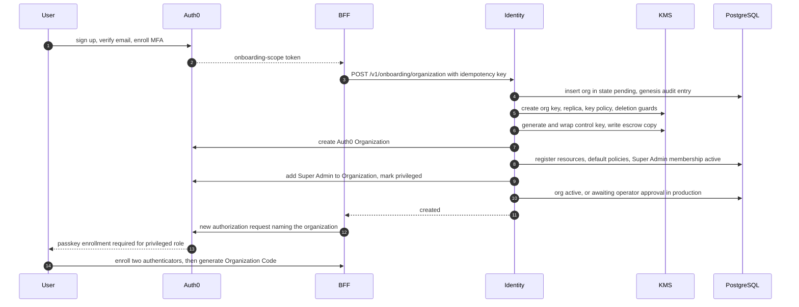
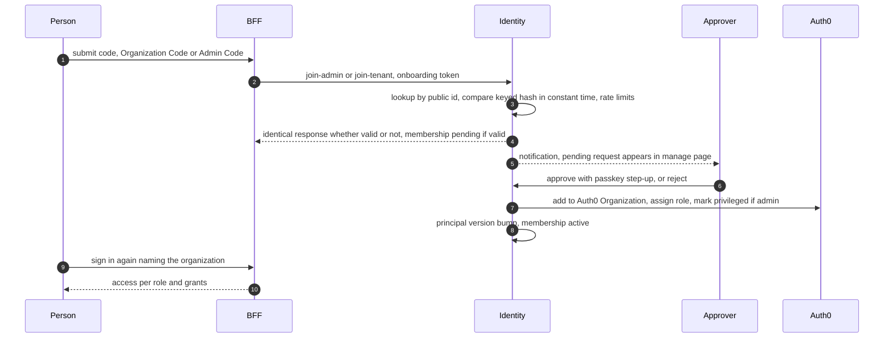

## 7. Onboarding, codes and lifecycle events

### 7.1 Common entry

1. The user signs up or logs in through Auth0 Universal Login. Email verification is mandatory; MFA enrollment is mandatory (privileged roles need a passkey or a WebAuthn factor, section 8.4).
2. A first login with no membership receives a token for a separate Auth0 API (audience `onboarding`) whose organization setting is "deny", exposing only onboarding endpoints. The main API's organization setting is "require", so an organization-less token cannot reach it.
3. The onboarding screen offers three cards: **Create organization** (Super Admin), **Join as admin**, **Join as tenant**. The card only selects a flow. The role is derived from the proof submitted (a valid code of the matching kind) and never from a client-supplied field.
4. On success the identity service writes the membership. A Super Admin is added to the new Auth0 Organization at once. An admin or tenant is added, with the Auth0 role, only when approved, so a pending user can never hold an organization-scoped token. The BFF then starts a new authorization request naming the Auth0 organization (silent if an Auth0 session exists, because a refresh token cannot gain an organization later) and receives `org_id`.

### 7.2 Path A: Super Admin creates an organization

No code is needed. The user supplies an organization name, deployment type (legal, medical, both) and data region. Abuse controls: verified email, mandatory MFA, disposable-domain blocking, per-IP creation limits, and in production operator approval (D9).

The saga is idempotent: each step records completion, a failure triggers compensation, and the organization stays `pending` and invisible until every step succeeds. The Organization Code is **not** generated in the saga (v2.1 would have held the plaintext until display, DEF-29); the Super Admin generates it with `POST /v1/org/code` once two authenticators are registered, and it is shown once. "Clean database" is satisfied logically (an empty partition under its own key); a physically dedicated database is the silo tier (section 10.10).

### 7.3 Path B: Admin joins an organization

The person enters the 64-character Organization Code. The identity service validates it, then creates a membership in `pending_approval` and a workspace in `pending`. The Super Admin sees the request in Manage Admins (or the co-owner for owner-linked requests) and approves or rejects. Approval moves the workspace through `provisioning` to `active` (partition, workspace content key, quotas), adds the user to the Auth0 Organization with the admin role, and sets `app_metadata.privileged` so the next authorization forces passkey enrollment. The Admin Code is generated only when the new admin selects Generate Admin Code (`POST /v1/workspace/code`) after their first privileged login; it is shown once to that admin and is never held in plaintext while waiting. Until then the user sees an "awaiting approval" page and has no data access.

The approval step exists because the Organization Code is a shared secret that will eventually be pasted into the wrong chat; without approval a leak is an admin takeover, with it a leak is a nuisance request. A stricter option is an invite-bound code locked to one email address.

### 7.4 Path C: Tenant joins a workspace

The person enters the 32-character Admin Code. The service resolves code → workspace → admin → org, shows "You are joining the workspace of [admin name]" for confirmation, and creates a `pending_approval` membership. The admin approves in Manage Tenants and can assign grants in the same step. Per-workspace policy can switch approval to `auto` or `domain_allowlist` (auto-approve only for listed email domains), but `manual` is the default for legal and medical workspaces. The confirmation screen is served by a preview endpoint that does not consume a use and returns the same error as a failed join for any invalid code.

### 7.5 Co-owner

A Super Admin can invite one co-owner (`co_owner_set`): an email-bound invite, accepted by the invitee with passkey registration, effective after a 72-hour cooling-off with notice to all admins. The co-owner holds the same `super_admin` role. Production organizations SHOULD designate a co-owner within 14 days of activation; without one, organization deletion and successor transfer fall back to the operator-verified second approver (section 6.7).

### 7.6 Code specification

| Property | Organization Code | Admin Code |
| --- | --- | --- |
| Length | 64 characters | 32 characters |
| Alphabet | Crockford Base32, upper case, displayed in groups of 8 | Same |
| Structure | 8-character public lookup ID, 55 secret characters, 1 Luhn mod-32 check character | 8-character public lookup ID, 23 secret characters, 1 Luhn mod-32 check character |
| Secret entropy | 275 bits (55 characters at 5 bits each) | 115 bits (23 characters at 5 bits each) |
| Generated by | Identity service, CSPRNG, at the owner's request | Same |
| Held by | Super Admin (shown once) | Admin of that workspace (shown once) |
| Bound to | `org_id` | `workspace_id` |
| Grants | A pending admin membership | A pending tenant membership |
| Stored as | Keyed HMAC-SHA-256 of kind plus full code, using a versioned server-side pepper held in the secret manager; plaintext lookup ID | Same |
| Display afterward | Lookup ID, creation and expiry dates, uses remaining. Not the last characters | Same |
| Default expiry / max uses | 30 days / 25 | 90 days / 100 |
| Rotation | Instant; pending requests are re-reviewed, not auto-approved | Same |

v2.1 claimed about 315 and 155 bits and also displayed the last four characters; the 8-character lookup ID is stored in plaintext, so only the secret portion counts, and showing trailing characters leaks more (DEF-11). Both secret portions are still far beyond brute force, so controls concentrate on **leakage and handling**:

- **Transport.** Invite links put the code in the URL fragment (`#`), which browsers never send to servers; the page reads it, removes it from history and posts it in a request body. The shared logging library redacts `code` fields. `Referrer-Policy: no-referrer` on onboarding pages.
- **Rate limits.** 5 failed attempts per user per 15 minutes, 20 per IP per hour, and a circuit breaker per lookup ID. Every failure returns the same "code invalid or expired" message; the true reason goes to the audit log only.
- **Verification.** Look up by public ID, then compare the HMAC in constant time.
- **Typos.** The check character lets the client catch mistakes before sending.
- **Alerts.** Notify the code owner on first use from a new country, bursts of use, or use right after a failed-attempt spike.

### 7.7 Lifecycle events and effects

| Event | Triggered by | Immediate effect | Data and codes |
| --- | --- | --- | --- |
| Organization created | New Super Admin | Org `pending` → `active` (production: after operator approval) | Org key, partition created; Organization Code generated later by the owner |
| Admin request submitted | Person with the Organization Code | Membership `pending_approval`; workspace `pending`; no access | Use counted on success only |
| Admin approved | Super Admin | Workspace `provisioning` → `active`; passkey enrollment forced | Admin Code generated by the admin after first privileged login |
| Admin rejected | Super Admin | Membership `rejected`; sessions revoked | Pending workspace removed |
| Admin suspended | Super Admin | Workspace `frozen`; admin and all tenants lose access in seconds | Data retained; Admin Code disabled; tenants `suspended` with `workspace_frozen` |
| Admin reactivated | Super Admin | Admin `active`, workspace `active`; only cascade-suspended tenants restored | Admin Code stays disabled until rotated |
| Admin removed | Super Admin | Workspace `frozen` for a 30-day decision window | Successor via `successor_transfer`; with no successor the workspace becomes `sealed`, unreadable by anyone, destroyed only after retention and legal hold end |
| Organization Code rotated or leaked | Super Admin | Old code dead at once | Pending requests re-reviewed; active admins unaffected |
| Admin Code rotated or leaked | Admin | Old code dead at once | Pending tenant requests re-reviewed; active tenants unaffected |
| Tenant approved | Admin | Membership `active`; grants applied | Scope hash refreshed |
| Tenant suspended or removed | Admin | Sessions revoked in seconds; streams cut | Private documents move to `held`. The admin sees only a metadata-only holding queue (ID, size, date, matter label, never title or text, DEF-12) and can delete them (key destroyed) or reassign them to another tenant on the same matter without opening them; reassigning to the admin personally is a break-glass access. Matter-shared documents are unchanged |
| Tenant leaves or requests deletion | Tenant | Membership closed | Authored content per retention schedule and legal hold |
| Wall created / lifted | Admin / governance request | Takes effect next request; streams cut | Notifications per section 5.6 |
| Emergency access invoked | Tenant | Time-boxed exception; admin notified | Review within 72 h |
| Super Admin loses access | Owner | Organization keeps running; no governance changes | `owner_recovery`, or the co-owner |
| Organization frozen | Operator | All sessions revoked; read-only export window | Nothing deleted |
| Organization deleted | Super Admin plus second approver | `deletion_pending` (30 days), then `sealed`, then `destroyed` | Section 12.7 |

### 7.8 Successor transfer

When an admin is removed or suspended the workspace is `frozen`. Because every user holds one membership and every admin one workspace in v1, the successor is always a **new admin identity**, never an existing admin. The Super Admin issues an email-bound **successor invite** (a join code of kind `successor`, bound to the frozen workspace); the invitee signs in, submits it, and a membership in `pending_approval` is created linked to the frozen workspace instead of a new one (no second workspace is created). The Super Admin then starts `successor_transfer` naming that pending membership. After the second approval and the 72-hour cooling-off, the transfer executes: the workspace is re-parented to the new admin, the membership becomes `active`, `admin_can_read_private` is reset to off, all walls and break-glass sessions are re-validated, every tenant and the outgoing admin receive notice, and an audit event is written that the Super Admin cannot suppress. If no successor is named within 30 days the workspace becomes `sealed`.